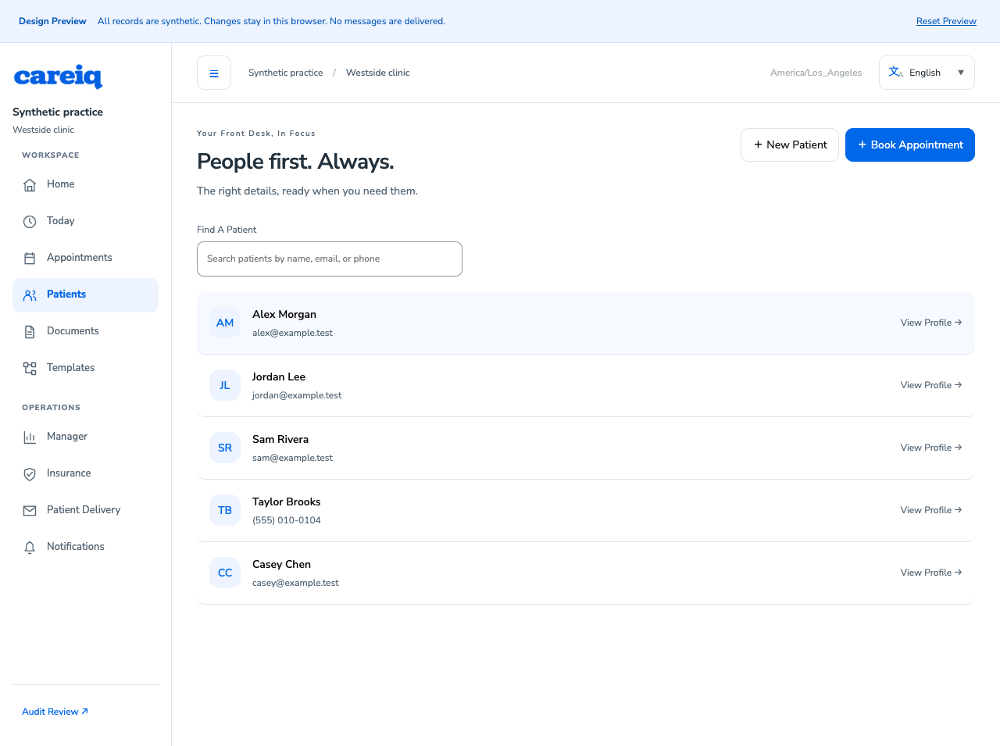
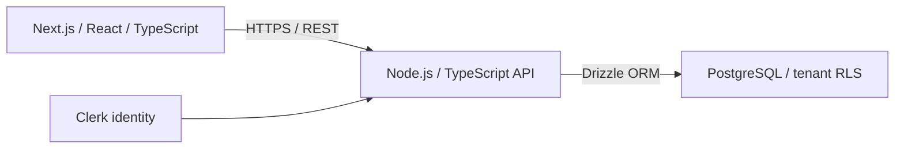

# CareIQ

[](https://github.com/kriscodes/careiq/actions/workflows/ci.yml)
[](https://github.com/kriscodes/careiq/actions/workflows/readiness.yml)

CareIQ is a healthcare operations platform for small and independent medical practices, focused on the administrative work around patient intake, appointments, paperwork, and staff coordination.

An independent product and engineering project by [Kristian Salmeron](https://kristiansalmeron.com/), spanning frontend and API architecture, multi-tenant data modeling, workflow design, and delivery.

**Active development · Synthetic/demo use only**



_Synthetic local verification capture · November 2, 2026. [Scope and verification](docs/verification/patient-row-spacing-2026-11-02.md)._

[Workflow scope](#workflow-scope) · [Architecture](#architecture) · [Run locally](#run-locally) · [Quality checks](#quality-checks) · [Current status](#current-status)

## Workflow scope

The current web/API implementation covers:

- Appointments, patient profiles, provider availability, and readiness requirements.
- Document/version review, guided forms, restricted patient collection and signing, and a completed-copy library.
- Manual insurance observations, corrections, and follow-up assignments.
- Manager team activity, staff notifications, and protected audit review.

The initial audience is practices with approximately 2–10 providers. CareIQ supports the operational workflows surrounding existing clinical systems; external EHR integration and broader automation remain separate product work. See the [product vision](docs/product-vision.md) and [workflow implementation guide](docs/workflow-implementation.md) for scope and activation boundaries.

## Architecture



The monorepo contains the authenticated web application, backend API, public marketing application, and shared packages. Infrastructure uses Render. Native mobile source was separated from the active workspace; retained server contracts support a future client.

Three decisions shape the implementation:

| Decision                                                                                            | Reason and tradeoff                                                                                                                                                                                                   |
| --------------------------------------------------------------------------------------------------- | --------------------------------------------------------------------------------------------------------------------------------------------------------------------------------------------------------------------- |
| [API-first platform](docs/decisions/002-api-first-platform.md)                                      | Keep business behavior and authorization in one backend that clients can share. This makes API contracts and compatibility a deliberate platform responsibility.                                                      |
| [Database-enforced tenant isolation](docs/decisions/007-multi-tenant-data-isolation.md)             | Combine explicit application scoping with transaction-local PostgreSQL RLS and a restricted runtime role. This adds policy, migration, and integration-test complexity in exchange for a second enforcement boundary. |
| [External identity, domain authorization](docs/decisions/017-practice-location-membership-model.md) | Map Clerk organizations to practices and narrow access through explicit permissions and location assignments. Identity, membership, and application resource access remain distinct concerns.                         |

[Architecture overview](docs/architecture.md) · [All architecture decisions](docs/decisions) · [Runtime API contract](docs/design/workflow/runtime-contract.md) · [OpenAPI definitions](docs/api/workflow.openapi.json)

## Run locally

### Prerequisites

- Node.js **22.23.4**, as pinned in [`.nvmrc`](.nvmrc), and pnpm **11.22.0**.
- PostgreSQL **18**, including its built-in `uuidv7()` function.
- A Clerk **test** application with Organizations enabled.

From a local checkout:

```sh
nvm use
pnpm install --frozen-lockfile
cp apps/api/.env.example apps/api/.env
cp apps/web/.env.example apps/web/.env.local
```

If you use another Node version manager, select the version in `.nvmrc` instead of running `nvm use`.

Configure both environment files with keys from the same Clerk test application. Point the API at an isolated local database; `DATABASE_SSL_MODE=disable` is for loopback PostgreSQL without TLS. Use separate migration-capable and restricted runtime database roles, following the [development guide](docs/development.md) and [database setup guidance](docs/security-hardening.md).

Apply the schema with the migration-capable role, then configure the API to use its restricted runtime role before starting the applications:

```sh
pnpm --filter ./apps/api db:migrate
pnpm dev
```

| Application | Local URL                      |
| ----------- | ------------------------------ |
| Web         | <http://localhost:3001>        |
| API health  | <http://localhost:3000/health> |
| Marketing   | <http://localhost:3002>        |

Practice creation requires an explicitly approved test user ID in the API configuration. Signing up does not automatically create a practice or grant clinical access. Use synthetic records.

For supervised previews on separate ports and a dedicated Docker database, follow the [isolated local review guide](docs/local-review.md). That guide also covers the synthetic workflow preview, runtime grants, and stopping only the processes owned by the review runner.

## Quality checks

With an isolated loopback test database named `careiq_test` configured, the core checks are:

```sh
pnpm lint
pnpm typecheck
pnpm test
pnpm build
```

`pnpm release:check` validates the test database target before running release checks. It includes component browser scenarios, browser workflows through the real API and restricted database, dependency regression checks, and the production dependency audit.

The [CI](.github/workflows/ci.yml) and [readiness](.github/workflows/readiness.yml) workflows also replay migrations on disposable PostgreSQL and build with reserved configuration fixtures. They do not deploy the application. Use [GitHub Actions](https://github.com/kriscodes/careiq/actions) for current run results; dated verification reports describe the revisions and acceptance boundaries they actually checked.

## Current status

| Surface                             | Recorded status                                                                                                                                                                                                                                                                                                        |
| ----------------------------------- | ---------------------------------------------------------------------------------------------------------------------------------------------------------------------------------------------------------------------------------------------------------------------------------------------------------------------- |
| Current `main`                      | Active development of the web/API workflows described above. [Implementation and review](docs/workflow-implementation.md)                                                                                                                                                                                              |
| Latest tagged release               | [v0.1.0 — Interview baseline](docs/releases/0.1.0.md), October 3, 2026. The tag is a named baseline and does not represent all subsequent work on `main`.                                                                                                                                                              |
| Last documented hosted verification | [November 2, 2026](docs/verification/e2e-release-2026-11-02.md): API and web deployed at `7d2cabe`; 17 public HTTP smoke checks passed in that recorded review. This is dated evidence, not a new live check.                                                                                                          |
| Remaining acceptance                | Authenticated hosted workflows, provider/device activation, older managed-owner workflow paths, and operating requirements retain the limits in the [release verification report](docs/verification/e2e-release-2026-11-02.md#known-limits-retained) and [owner checklist](docs/security/owner-security-checklist.md). |
| Usage boundary                      | Synthetic/demo use only. Local safeguards and passing automated checks do not establish readiness for real patient production use.                                                                                                                                                                                     |

[Version history](CHANGELOG.md) · [Release process](docs/releasing.md) · [Deployment evidence](docs/deployment/security-release-status.md)

## Documentation

| Area                        | Start here                                                                                                                                                                                     |
| --------------------------- | ---------------------------------------------------------------------------------------------------------------------------------------------------------------------------------------------- |
| Product and workflows       | [Product vision](docs/product-vision.md), [workflow implementation](docs/workflow-implementation.md), [Forms Studio and paperwork](docs/forms-studio-implementation.md)                        |
| Staff operations            | [Manager and manual insurance verification](docs/manager-insurance-implementation.md), [team activity](docs/manager-team-activity.md), [notifications](docs/notifications-implementation.md)   |
| Engineering                 | [Architecture](docs/architecture.md), [ADRs](docs/decisions), [API contract](docs/design/workflow/runtime-contract.md)                                                                         |
| Development                 | [Setup and deployment](docs/development.md), [isolated local review](docs/local-review.md), [authentication and onboarding](docs/auth-onboarding.md)                                           |
| Verification and operations | [November 2 release verification](docs/verification/e2e-release-2026-11-02.md), [security hardening](docs/security-hardening.md), [owner checklist](docs/security/owner-security-checklist.md) |
| Historical context          | [Development history and earlier verification references](docs/development-history.md), [mobile separation](docs/mobile-separation.md)                                                         |

CareIQ is developed around complete vertical workflows. Architectural decisions are recorded where they affect data boundaries, API contracts, or operating behavior; product details evolve through discovery and review.
