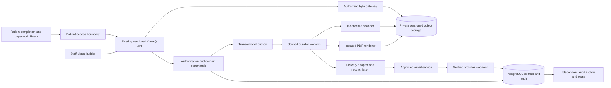
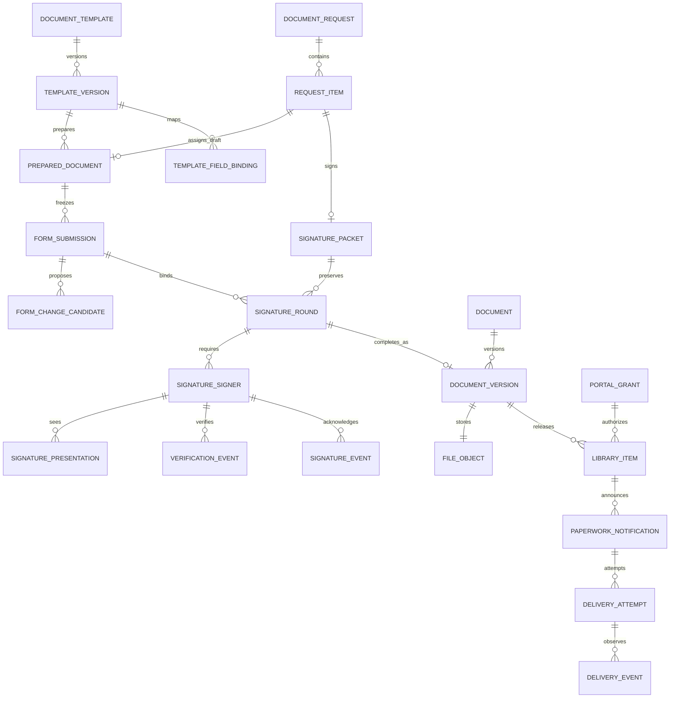

# CareIQ Forms Architecture and Database Design

Design proposal · October 17, 2026 · Extends the locally implemented workflow

CareIQ should extend its existing forms, document and signing workflow into a visual builder, patient completion experience and paperwork library. PostgreSQL remains authoritative for answers, ownership, policy and workflow. Private object storage holds immutable sources, completed PDFs and signing evidence. A completed document becomes available in the application before a separate delivery process emails its authorized recipient a secure link.

This proposal does not change application code, migrations, provider configuration or production data. Existing local implementation and proposed work are separated below. Legal effectiveness depends on the document, jurisdiction, applicable rules and actual process; a drawn signature or matching hash alone cannot establish it.

## Existing foundation and proposed extensions

The canonical working checkout is `/Users/kristian/Documents/Server/CareIQ`. Its [local implementation record](/Users/kristian/Documents/Server/CareIQ/docs/workflow-implementation.md), [runtime contract](/Users/kristian/Documents/Server/CareIQ/docs/design/workflow/runtime-contract.md) and [workflow schema](/Users/kristian/Documents/Server/CareIQ/apps/api/src/db/schema/workflow.ts) supersede older project-mirror implementation notes for this feature.

| Area | Existing local foundation | Proposed work |
| --- | --- | --- |
| Forms | Structured field editor; draft revisions; immutable publication; frozen generated PDFs | Full visual layout, PDF overlay import, conditional/repeating fields, reusable sections, patient answer editing, bilingual publication validation |
| Signing | Restricted request-only cookie; consent; typed/drawn web signing; typed native signing; original pages plus signing record and separate evidence | Stronger configured recipient assurance; representative authority; multiple required signer roles; immutable signing rounds; explicit verification report |
| Documents | Scoped immutable versions, private local objects, byte/hash validation, quarantine, review/corrections, evidence/readiness | Versioned external object storage; isolated renderer; operational scan service; durable completion workers; retention-aware reconciliation |
| Audit | Dedicated protected audit schema, classified changes, independent DB evidence, denial capture, scoped reads/exports | Extend existing catalog and capture policy to new form, recipient, mapping, library and delivery commands; independent archive seals and restore drills |
| Delivery | Attempt/outbox records and truthful provider-unavailable state | Configured provider, post-completion notifications, current preference checks, webhook verification, reconciliation, bounce handling |
| Patient access | Request-bound restricted session | Persistent authenticated paperwork library with explicit patient/proxy grants; completed-request access remains tightly scoped |

Local execution currently performs scanning, rendering and signing synchronously while recording durable operations/runs. A production worker fleet, external immutable storage, production scanner, delivery provider and physical native-device acceptance remain activation work. This design does not claim they are deployed.

## Component boundaries



Keep the current REST boundary and staff namespace `/api/v1/locations/{locationId}/workflow`. Templates are practice configuration, even when accessed through a selected location; they never contain patient information. The patient API has separate principal/session validation and cannot call staff commands. A portal account does not automatically inherit organization membership or clinical permissions.

The existing restricted workflow is appropriate for completing one request. A paperwork library needs a separate authenticated access model; widening a request token into patient-wide access is prohibited. Patient-to-account matching requires an approved binding workflow and staff or independent verification, never equality of email address or name.

## Data ownership and isolation

Use the existing UUIDv7 entity strategy, UTC `timestamptz`, constrained states and positive revisions. Every patient-bearing row carries `practice_id`, `location_id` and `patient_id`. Practice configuration carries `practice_id` but no patient identifiers. Patients remain location-owned under ADR-017; this proposal introduces no cross-location patient directory or automatic merging.

Clinical references use composite foreign keys containing `(id, patient_id, practice_id, location_id)` where patient agreement matters. Practice-level references include `(id, practice_id)`. A current version pointer also includes its parent document ID. `ON DELETE RESTRICT` protects retained clinical history. Actor removal does not cascade into document or evidence deletion.

Use forced RLS with transaction-local validated principal, practice and location context, plus explicit query predicates and command authorization. Missing or invalid context denies access. Staff access requires current Clerk permission, active enrollment and active location assignment. Jobs use a narrowly scoped machine identity and explicit aggregate scope. Patient policies require the exact live request/signer or explicit portal grant. Do not use a permissive patient policy that accidentally combines with staff policies to widen access. PostgreSQL owners and `BYPASSRLS` roles can bypass ordinary RLS, so the actual runtime role must remain a non-owner without privileged memberships. [PostgreSQL row security](https://www.postgresql.org/docs/current/ddl-rowsecurity.html).

## Database extensions

These are proposed changes to existing records and proposed new supporting tables. Names are intended for implementation review, not executed migrations.

### Authoring and structured submissions

| Record | Design and constraints |
| --- | --- |
| `document_templates` existing | Retain logical identity, document type, active flag, published pointer and revision. Add optional authoring mode `guided/pdf_overlay`, category and explicit practice-level sharing policy. Deactivation stops new use; it does not rewrite existing requests. |
| `template_versions` existing | Extend `schema_version` to v2. Retain immutable published content, stable field keys, content hash and asset. Add validated `layout_schema`, conditional/repeating-field schema, completion policy `form_only/form_then_sign`, signer policy version reference when required, consent/version references, renderer profile, accessibility metadata and default locale. A published version references exact translated content versions. |
| `template_translations` new | Practice/template-version/locale, translated text and labels, translation revision/hash and approved actor/time. Publication freezes required locales. Locale fallback must be explicit before signing; never replace a legal notice invisibly. |
| `template_publication_checks` new | Immutable validation run: template draft revision/hash, ruleset version, results and artifact references. Gate publication on unique keys, reachable required fields, bounded conditional logic, valid page geometry, no missing signer-role assignment, accessible labels and passing PDF preview. A successful check for an older draft does not authorize a newer one. |
| `prepared_documents` existing | Keep mutable draft answers and exact template version. Add schema-version, draft owner/request item and answer revision. Patient updates receive a narrowly scoped route. Frozen/preparing/ready instances reject answer changes; an amendment creates a new prepared record. |
| `form_submissions` new | Immutable frozen answer snapshot linked to existing prepared document, exact template version, request item, patient/scope, submission sequence, answers JSONB, schema/answers hashes, submitted actor/server time, prefill provenance and locale. Unique `(prepared_document_id, submission_sequence)`. A submission is authoritative source data, separate from current chart facts. |
| `template_field_bindings` new | Practice/template-version/field-key, allowed destination, normalization version, sensitivity, `review_required`, conflict policy and approved mapping version. Destination is a registered domain operation, never arbitrary SQL, table/column path or client-supplied property. Published bindings are immutable. |
| `form_change_candidates` new | Submission/field/binding, destination record and base revision, protected proposed value/reference, source provenance, state `pending/accepted/rejected/conflicted/superseded`. Unique submission/binding/destination. Staff approval rechecks permissions and destination revision. |
| `form_change_decisions` new | Append-only decision, actor/server time, reason, supersedes decision if corrected, source candidate and audit event. Applied change links the domain mutation and exact destination revision in the same transaction. No medical facts are automatically accepted because a patient signed. |
| `document_requests`, `document_request_items` existing, v2 extension proposed | Add an explicitly reviewed `form_completion` purpose and a scoped prepared-draft reference for the single request item. Pin the exact published template and server-derived completion policy `form_only/form_then_sign`. The request may be open before source/submission exists; its completion phase is distinct from the existing request-state enum. A source/submission and, when required, packet/round are bound only after verified freeze. Composite FKs and command checks require the same request item, patient, practice and location; an unrelated draft cannot be substituted. Existing v1 and already-frozen signature requests retain their current constraints. |

Prefer validated JSONB for bounded heterogeneous answer trees; preserve stable keys, explicit null/unknown/declined distinctions, typed dates and units. Use dedicated relational clinical models for medications, allergies, insurance and other reviewed chart data. The current local patient model supports demographics; broader medical models and reconciliation remain separate design/implementation work.

### Conditional answers and interrupted completion

Published rules define applicability and limits; the server evaluates them on every save and freeze. An answer that becomes inapplicable must not silently enter the final PDF, active frozen answer set or chart-change candidates. Preserve prior draft history only under its classified retention policy; keep inactive values outside the submitted source and do not restore them as confirmed answers when a branch becomes applicable again. Ask the patient to review and confirm them. Repeating sections use stable item IDs rather than array positions, with published count, depth and payload limits. Freeze records the ruleset version, active item/field set and applicable values together.

The patient interface shows `Saving`, `Saved`, `Save failed` or `Connection unavailable` accurately. `Saved` requires an accepted server draft revision; a local keystroke or queued request is insufficient. Inline validation and a focused error summary identify what needs attention. Freeze/sign actions wait for the latest accepted revision and block on unresolved save errors. An interrupted or expired session resumes a server-held draft only after fresh authority for the same live request; never put PHI in localStorage or revive a revoked grant. Sign-out, identity/scope changes and lost authority clear protected client memory according to policy. A safe reauthentication path and staff assistance explain how to continue.

### Patient form request before signing

Patient-authored forms need a request before their answers can be frozen. The proposed v2 `form_completion` mode starts with a pinned template and scoped prepared draft, not a fabricated source PDF or signing round. Patient edits use that request's restricted draft authority. Freeze/render work is durable and revision-bound; before publishing the verified result, lock the request/item/draft, check expiry, cancellation, exact draft revision and worker fencing, then atomically bind the immutable submission/source and create the required packet/round plus audit/outbox work. A stale or cancelled operation cannot activate signing. Only then can the patient review the exact assigned presentation and acknowledge signature intent.

The published policy also supports forms that need no signature. For `form_only`, explicit patient submission and a verified frozen output create an **unsigned submitted copy**, with the same durable library/notification and governed-review rules. Do not create a synthetic signer, show a signature badge, or treat submission as consent. For `form_then_sign`, final completion still waits for all required eligible signer acknowledgements. These are proposed schema/API extensions; existing v1 request purposes and clients must not silently accept them.

For uploaded outside documents, retain original bytes, extracted text/OCR as a versioned derivative, extraction tool/model version, page and bounding region, confidence and reviewer corrections. Store candidates in the same governed review process with an extraction source reference. No OCR or generated interpretation silently changes the chart. Documents with no useful structured mapping remain searchable reference records.

### Signing and authority

| Record | Design and constraints |
| --- | --- |
| `signature_packets` existing | Retain request identity, frozen source/output and consent/evidence references. Add signing-policy version, immutable submission ID, source manifest hash and current signing-round pointer. Existing one-signer packets remain supported under v1 semantics. New semantics require explicit versioning and feature gating. |
| `signing_policy_versions` new | Practice-owned immutable category/version with required roles/count/order, allowed methods, minimum assurance/freshness, representative rules, consent versions, finalization deadline and supported alternative. Server approval is required; clients cannot lower policy on a request. |
| `signature_rounds` new | Packet, positive sequence, exact source version, submission, signer-policy/consent versions, round manifest, state, expiry, finalization operation/result references and revision. Unique packet/sequence; at most one live round per packet. After dispatch, no source, answers, required roles or required fields may change. |
| `signature_signers` new | Round, role key, required flag, signing order/group, intended recipient, verified account/session identity reference, authority snapshot, minimum assurance policy, `assigned_presentation_version_id`, assigned presentation hash and state `awaiting/ready/acknowledged/declined/revoked`. Unique round/role instance. Presentation FK includes round ownership through a validated presentation record plus patient/practice/location agreement. Recipient corrections invalidate old grants and usually create a new round if identity/authority or required-party semantics change. |
| `signature_presentations` new | Immutable round/signer assignment, exact document version and hash, common source-manifest hash, prior acknowledgement IDs included visually, renderer/operation reference and creation time. Composite scoped FKs bind presentation to the same signer/round/patient. Common-source signers may share immutable bytes through separate assignments. Once assigned/presented, a different substantive presentation requires a new round and fresh acknowledgement. |
| `signature_fields` existing | Add `round_id` and `signer_id` with scope/patient/packet agreement. Required/conditional applicability is evaluated and frozen before signing. All signature/initial fields have exactly one eligible role. Preserve geometry checks, input-size limits and immutable submitted values in evidence. |
| `patient_access_grants`, `patient_sessions` existing | Add purpose-checked scoped references for `complete_form/sign_document/view_completed_copy`. A `complete_form` grant binds one live request/item/prepared draft and verified intended respondent; it may exist before a round/signer and cannot call signing or historical-document routes. A `sign_document` grant requires exact round/signer assignment and can submit only that signer's fields. After freeze, issue or rotate to a purpose-limited signing grant only after required signer/authority checks; never let a null round become a wildcard. Retain one-time token exchange, hash-only secrets, session expiry and revocation. No request token upgrades to library access. |
| `signer_verification_events` new | Append-only challenge, attempted/succeeded/failed result, method, actual assurance, trusted verifier, bound signer/round/session, server time, expiry and protected evidence reference. Never claim real-world identity solely from email-link possession. |
| `representative_authority_records` new | Patient/scope, representative principal, role/relationship, authority type/scope, effective/expiry dates, verification and document references, reviewer and revocation facts. A parent label or shared inbox does not establish authority. Signing and viewing grants are distinct. |
| `consent_text_versions` new | Practice, category, version, locale, immutable text/hash, effective rules and approval. Separate electronic-record delivery, signing intent, treatment consent, privacy acknowledgment, records authorization and communication preferences. Do not require unrelated optional authorization to complete intake. |
| `consent_acceptance_events` new | Exact version/hash, person/role, scope, document/round, method and server time. Withdrawal/revocation appends a new event with effective time; previous events and signed documents remain. Record withdrawal method and prospective processing. |
| `signature_events` existing | Extend with round/signer/assigned-presentation version/hash, verification/authority/manifest references and explicit event type. Preserve consent, source/output evidence and canonical audit linkage. Store sensitive network/device details only under an approved evidence policy. |
| `signature_verification_runs` new | Immutable run against exact output/evidence object versions and hashes; input manifest, policy, checker/tool version, findings, server time and attestation/certificate results. New checks append, never replace old reports. |
| `document_amendments` new | Original document/version/round, replacement document/version/round, reason, requester/approver/time, effective disposition and audit link. A completed original cannot be edited, erased or relabeled as never signed. |

Required signer membership and order are policy, not browser state. Parallel signers sign the same frozen answer/source manifest and an exact assigned presentation. If policy requires a later signer to see earlier signature appearances, a durable presentation-render operation generates and verifies an immutable intermediate PDF. Under the round/signer locks, assign its exact scoped version/hash and prior acknowledgement set before that signer becomes ready. `GET /document` returns only that assignment; completion must echo its version/hash. An incomplete or missing intermediate artifact leaves the signer awaiting, never ready. Preserve each presentation and the common underlying content manifest in final evidence. Never reuse a signature acknowledgement on changed substantive content.

Guardian/representative rules and access boundaries depend on applicable law and the specific health matter. HHS notes that authority and parental access have exceptions and state-law dependencies. [HHS representatives and minors](https://www.hhs.gov/hipaa/for-professionals/faq/personal-representatives-and-minors/index.html).

### Document delivery and patient library

| Record | Design and constraints |
| --- | --- |
| `documents`, `document_versions`, `file_objects` existing | Retain immutable sources and outputs. Add submission/round/provenance references and immutable external storage version IDs. No overwrite under an existing object identity. The library references exact completed versions, not a moving current pointer. |
| `patient_portal_grants` new | Verified portal principal, patient/practice/location, allowed document categories, authority basis, effective/expiry dates and revoked facts. Explicit grants only; no implicit cross-location access. Minors, proxy scope changes and age transitions require policy reconciliation. |
| `patient_document_library_items` new | Exact document version, intended patient/principal audience, availability time, publication policy/release reason, originating completion event, supersession/amendment references and revision. Unique completed version/audience. Do not publish staff-only notes or raw forensic evidence by default. |
| `patient_communication_preferences` new | Patient or verified representative, purpose/category, channel, verified destination reference, preferred locale, confidentiality restrictions, effective event/version, opt-in/opt-out and policy basis. Current state is a projection of append-only preference events. Contact changes do not retroactively change old destination snapshots. |
| `paperwork_notifications` new | Completed version/library item, authorized recipient, purpose, preference/policy version, originating event, state `pending/queued/suppressed/settled/needs_attention`, reason and idempotency key. `settled` means the intent was handled; delivery outcome remains separate. Unique completed version/recipient/purpose/policy generation. An amendment generates a new notification intent. |
| `delivery_attempts` existing | Extend purpose to `paperwork_ready/paperwork_resend` in addition to initial/reminder/reissue. Add notification and exact document-version references. Preserve a request FK for legacy request deliveries; new subjects require an explicit constrained subject kind and valid composite reference, not an unvalidated polymorphic UUID. Every actual provider call gets an attempt. |
| `delivery_events` new | Append-only provider/attempt event with normalized event type, provider event ID and source/received times. Separate dispatch status `queued/submitting/accepted/unknown/failed` from delivery outcome `unconfirmed/delivered/bounced/complained/suppressed`. A late bounce remains possible after a delivery event. |
| `provider_webhook_receipts` existing | Verify provider signature using raw body, timestamp policy and active secret/version; deduplicate provider/account/event ID. Resolve an existing attempt before trusting tenant scope. Invalid/unmatched receipts use platform security evidence, not caller-supplied tenant IDs. |
| `document_access_grants`, `file_access_observations` existing | Add portal principal and library-item references. Keep authorization/transfer/client-view facts distinct. Repeat requests issue freshly authorized grants; no replay of expired URLs. A client-view report is labeled client-reported, never proof that the person read the document. |

The patient library exists independently of email delivery. If email is suppressed or fails, the authorized copy remains available in the application and staff receive actionable follow-up. Completed signed paperwork is normally released immediately; clinical reports and other document classes may require a separate release policy. Proxy recipients receive only the documents authorized by their current grant, not every item associated with the same patient.

The interface and notification locale are preferences independent of the frozen document/legal language. Switching the application to Spanish must not swap a previously signed English consent. An offered translated form is a separately approved published version, selected before freeze and retained with the signing evidence. Required verification or representative checks fail closed if unavailable; the patient is offered a supported alternative or staff assistance, never a silent assurance downgrade.

### Existing operational and audit records

Extend `workflow_operations`, `workflow_request_keys`, `job_runs`, `outbox_events`, `file_scan_runs`, `document_retention`, `document_holds` and the existing `audit` schema. Do not introduce a second job queue or parallel activity authority. Add durable operation kinds for render, freeze, signature finalization, verification, library publication, notification dispatch and reconciliation. Each run preserves actual executor, initiator, scope, input revisions/hashes, fencing token, outcome and safe failure code.

Signed data, signature images and consent evidence remain protected domain records; routine audit uses policy-classified changes and protected references. Existing audit tables remain the authoritative history: application events, event resources, classified changes and independent database mutation evidence. Customer activity is a permission-filtered projection.

## Main relationships



The database FK from the existing packet remains packet → request, with one frozen source item in the current v1 contract. The diagram's request-item association expresses the domain requirement. Multi-document packets are a later explicit extension; this revision does not silently change existing one-document request behavior.

## State and version rules

| Aggregate | Proposed lifecycle | Required rule |
| --- | --- | --- |
| Template version | draft → published; retired blocks new use | Published content is immutable. New edits create a draft version; old requests retain exact old versions. |
| Prepared answers | draft → freezing → frozen; rejected validation returns to draft | No answer changes after freeze; editing creates a successor prepared record/submission and a new round when signing is required. |
| Form-completion phase (v2 projection) | awaiting_answers → preparing_review → ready_to_sign → completing → completed; form_only skips signing | The open request pins one authorized draft. No signing authority exists before verified freeze/assignment. Cancellation, expiry and stale draft/worker checks apply before binding the result. An unsigned submission is never labeled signed. |
| Signature round | pending → completing → completed; pending → declined/cancelled/expired; completing → cancelled or failed | Only all required, eligible signer acknowledgements permit finalization. Failed finalization preserves accepted evidence and resumes the same operation safely or requires a new round if authority/content changed. |
| Signer | awaiting → ready → acknowledged; ready → declined; live → revoked | Acknowledgement binds exact content, consent, role and verification evidence. The UI says signature received while final output is preparing. |
| File | reserved → uploaded → scanning → available; unsafe/error → quarantined/rejected | Fail closed on scanner failure. Controlled renderer output has separate provenance; it never claims an upload scan it did not receive. |
| Notification | pending → queued → settled or needs_attention; pending/queued → suppressed | In-app publication and completion are not rolled back by provider failure. Current delivery permission is checked again at dispatch; settled does not mean delivered or read. |
| Review | pending → accepted or replacement required; correction appends successor | Signing completion does not imply clinical/staff acceptance or visit readiness. |

Keep existing v1 packet states/API behavior compatible during rollout. `freezing/frozen` are new form-draft semantics, not silently substituted into the existing `prepared_documents.state` enum. Implement via explicit schema-versioned extension or separate freeze status with reviewed client handling.

Expiry stops new signature acknowledgements. If every required acknowledgement was durably accepted and the finalization operation reserved before expiry, a round already `completing` may finish after that cutoff within its operational deadline; scheduled expiry only transitions `pending`. Cancellation can still win before final commit. This distinction must be visible in the contract and tests. Changing it later requires an explicit policy version.

## Durable completion protocol

```mermaid
sequenceDiagram
    participant P as Patient or signer
    participant A as Existing API
    participant D as PostgreSQL
    participant W as Scoped worker
    participant O as Private object store
    participant E as Email adapter
    P->>A: Acknowledge exact frozen source and consent
    A->>D: Begin transaction; lock round, request and authority; validate revision and expiry
    A->>D: Insert immutable signer event and audit
    alt All required signers acknowledged
        A->>D: Transition to completing; reserve operation and outbox; commit acknowledgement and work together
        A-->>P: 202 preparing with same operation receipt
        W->>D: Claim run and fencing lease
        W->>O: Write immutable output and evidence manifest
        W->>O: Verify exact object versions, bytes and hashes
        W->>D: Lock and recheck active round, policy, authority and lease
        W->>D: Atomic completion plus library publication plus notification outbox and audit
        W->>D: Recheck current communication permission
        W->>E: Minimal email with authenticated application link
        E-->>D: Verified delivery events through webhook
    else Other required signatures remain
        A->>D: Commit signer event and audit
        A-->>P: Signature received; awaiting required signer
    end
```

1. Freeze the exact answers, schema, template, locale, prefilled values/provenance, source PDF, required signer policy and consent text. Preserve stored canonical bytes and canonicalization/renderer versions. A digest references these immutable facts; it is not a substitute for retaining them.
2. Each acknowledgement rechecks the live request, signer, role, representative authority, assurance freshness, exact source/consent/round, assigned immutable presentation version/hash and all applicable fields. The server sets authoritative time. Record signed intent explicitly. Earlier signer acknowledgements may commit individually while other required signers remain; any next-step presentation-render handoff required by policy commits atomically with that acknowledgement and audit.
3. For the last required acknowledgement, insert the signer fact, evaluate the all-required gate, transition pending → completing, reserve the unique finalization operation, insert its outbox handoff and audit, and commit all of these in one transaction under common request/round locks. A crash cannot leave all required signatures accepted without durable finalization work. Business uniqueness persists beyond transport retry-key expiration. Retry returns the authorized original receipt, never creates another signing completion.
4. The worker uses immutable input references, resource limits and no external network. Write output, machine-readable evidence and patient-readable signing record to distinct immutable objects. Evidence contains artifact hashes, required/actual roles, timestamps, identity method, consent and input references. Do not make an evidence hash circular by embedding it in the bytes being hashed; keep a detached final manifest/seal that binds the evidence and output digests.
5. Verify the exact stored versions, checksums, length, readability and retention assignment; retain run/toolchain provenance. A detached CareIQ key seal, if configured, attests to CareIQ's evidence manifest. It is not the patient's certificate signature.
6. Reacquire locks and check fencing token, active round, all required acknowledgements, no invalidation, current required authority and object readiness. Atomically commit `completed`, immutable output/evidence references, completion event, library item and notification outbox. No endpoint reports completed before these facts are durable.
7. If cancellation wins the lock first, revoke live grants/sessions and prevent worker publication. If completion wins, later cancellation cannot erase it: create a reasoned void/amendment event and replacement workflow. Orphan bytes remain private until retention-aware reconciliation determines disposition.

Do not regenerate a historical signed document from today's patient chart or latest template. Corrections, recipient replacement, signer policy changes and changed substantive answers require an explicit successor; retain previous round, evidence and reason. Existing submitted signatures cannot be pasted onto the replacement.

## Automatic emails and application copies

Default delivery is an automatic minimal notification after durable completion: “Your paperwork is ready. Sign in to view or download your copy.” The button opens a fixed first-party application route with an opaque notification reference; authentication and resource authorization are still required. No patient name, diagnosis, form category, answer, signature, attachment or direct object URL appears in the subject/body, analytics or click-tracking service. A branded sender can itself reveal a care relationship, so confidentiality preferences still govern the notification.

Publication and completion record the intended recipient and current permission/policy version. Dispatch checks verified destination, communication restrictions, revocations and suppression again immediately before the provider call. If permission is absent, return `suppressed` with a reason; the in-app copy remains available. Rechecking cannot retract an email that a provider already accepted. Record the side-effect boundary and reconcile in-flight preference changes honestly.

HHS allows patient email communication with reasonable safeguards and accommodation of reasonable alternative communication requests. [HHS patient email guidance](https://www.hhs.gov/hipaa/for-professionals/faq/does-hipaa-permit-health-care-providers-to-use-email-to-discuss-health-issues-with-patients/index.html). The default secure-link policy is CareIQ's proposed product choice. Requests for an unencrypted copy require a separate supported access workflow with documented warning/choice and destination checks; do not enable routine attachments merely by checking a general signing-consent box. [HHS requested transmission methods](https://www.hhs.gov/hipaa/for-professionals/faq/do-individuals-have-the-right-under-hipaa-to-have/index.html).

Provider acceptance, delivery, application visit, PDF transfer, signature acknowledgement and staff review are separate states. Disable tracking pixels. Provider open/click data, if retained at all, is an unreliable automated observation and does not mark paperwork viewed. Use provider idempotency and stable message keys where available; ambiguous timeout becomes `unknown` until queried/reconciled. Do not promise exactly-once email. Hard bounces/complaints suppress further automatic attempts and open staff follow-up; reminders honor current preferences, cooldown and request lifecycle.

An optional future PDF attachment setting requires separately approved patient preference and practice policy, a verified destination, content-minimized subject/body and applicable provider/BAA controls. It sends the exact immutable completed copy and records the disclosure/delivery evidence. It is off by default. This request authorizes the design, not any live patient email, attachment or provider activation.

## Signature verification outcomes

Provide an authorized verification report for an exact completed version with independent findings:

| Finding | Values and meaning |
| --- | --- |
| Integrity | `matches / mismatch / unavailable / not_checked` for stored source, every signer presentation, output, evidence and manifest |
| Required signers | `complete / incomplete / invalidated` against the frozen policy |
| Identity evidence | Actual method and assurance result, including `link_possession_only`, `authenticated_account`, `verified_representative`, `insufficient` |
| CareIQ attestation | `verified / invalid / missing / unsupported`, key ID, algorithm and verification time |
| PDF certificate signature | `valid / invalid / indeterminate / not_present / unsupported`, with trust chain/revocation/timestamp details only when implemented |
| Document standing | `current / amended / voided / superseded / restricted` with the reasoned successor reference available to authorized readers |

Return findings rather than a single green “legally valid” badge. A hash match establishes agreement with the stored reference under the check; it does not prove who signed. The current implementation uses a visible electronic signing record and link possession. `pdf-lib` explicitly lacks specialized APIs for creating or validating digital signatures, so any certificate-based PAdES/PDF trust capability requires a separate component and acceptance policy. [PDFSignature documentation](https://pdf-lib.js.org/docs/api/classes/pdfsignature).

Each report shows `verifiedAt`, inputs and policy version, and whether the findings are current, stale or unavailable. An old successful run cannot conceal a later integrity mismatch, authority invalidation or failed verification. Signing time and any later certificate/revocation-check time remain separate; a certificate revoked later does not by itself establish its historical status at signing without the required trusted evidence.

## Retention and recovery

Keep sources, frozen submissions, signed outputs, consent/authority evidence, amendments, delivery facts and audit under classified policies. Retention anchors differ by record type; minors, record category, state rules, practice contract and holds can change them. Do not prescribe one universal medical-record retention period. CareIQ's accepted ADR-010 specifies a minimum six-year audit baseline; this is the project's policy baseline. HIPAA's six-year Security Rule documentation requirement is a separate rule, not a universal mandate that every medical PDF or every log be retained exactly six years. [45 CFR 164.316](https://www.ecfr.gov/current/title-45/subtitle-A/subchapter-C/part-164/subpart-C/section-164.316).

No physical disposal runs until approved policies and holds are executable. External storage needs object version IDs, deny-overwrite/delete grants, retention/hold controls and separation of deletion authority. Store audit seals/manifests under independent control. Test restoring DB and object versions together, reconciliation of broken references and resumption of finalization/email after a crash. Legal holds override routine cleanup, including orphan cleanup. Key rotation preserves verification of historical attestations; key-loss and compromise procedures must be documented.

Where E-SIGN applies to legally required written consumer disclosures, its electronic-record consent provisions address affirmative consent, access/retention capability, paper options and withdrawal, and its retention provisions require accurate and accessible reproduction. Template review must determine applicability and any state/specialty-specific requirements before activating a document category. [15 USC 7001](https://www.govinfo.gov/content/pkg/USCODE-2024-title15/html/USCODE-2024-title15-chap96-subchapI-sec7001.htm).

## Practice uses and governed database integration

| Document use | Structured integration | Required boundary |
| --- | --- | --- |
| Intake/history | Patient-reported demographics and clinical change candidates | Sensitive/clinical answers require the appropriate reviewer; signed history is not an authenticated diagnosis |
| Treatment/procedure/telehealth consent | Versioned consent type, encounter, signers and renewal rules | Separate legal template and authority policy per category |
| Privacy acknowledgment | Notice version and acknowledgment outcome | Do not label it a treatment consent or records authorization |
| Records release | Scope, recipient, purpose, expiry, revocation | Valid authorization elements and disclosure checks remain distinct; general consent does not substitute. [HHS distinction](https://www.hhs.gov/hipaa/for-professionals/faq/what-is-the-difference-between-consent-and-authorization/index.html) |
| Insurance/prior authorization | Coverage and submission workflow candidates | Insurance models, payer integrations and submission receipts need separate implementation |
| Referrals/outside reports | Referral links, document review and extraction candidates | Retain original provenance; deduplicate without silently merging patients |
| Results/instructions | Encounter/care-plan links and release policy | Clinical release rules differ from automatic release of signed patient paperwork |
| Letters/certificates | Approved template plus permitted chart merge fields | Authorized signer, controlled data selection and immutable issued copy |
| Estimates/receipts/financial agreements | Billing record links and signed financial terms | Payments and card data remain outside form answers |
| Practice policies/staff contracts | Practice library and credentials/expiry | Separate staff/admin audience and storage grants; no patient library publication |

## Decisions required before production activation

Choose approved signing categories/jurisdictions and their legal/clinical owners; recipient assurance and account-binding policies; proxy/minor handling; translated legal text approval; email provider/BAA and domain authentication; versioned storage/scanner/renderer providers; retention/hold policies and restore objectives; and whether certificate-based PDF signatures are required for any category. These decisions do not block design review. Their implementation remains To do until verified in the intended environment.
