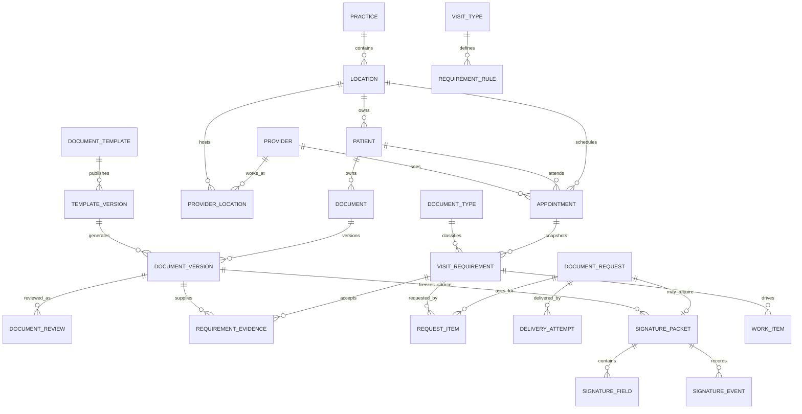

# CareIQ workflow database and API design

Draft for review · Revision 2 · October 16, 2026

This design supports Today, patient profiles, scheduling, visit preparation, document collection, staff review, versioned templates and patient signing across web, iOS and Android. PostgreSQL owns workflow state and relationships; private object storage holds immutable file bytes. Clerk remains authoritative for identity, membership roles and permissions.

The core decision is to separate a visit requirement from its document, a document from its immutable versions, staff review from signing, and a request from its delivery attempts. Readiness is calculated for an appointment from those records. It is never a patient-wide checkbox.

Revision 2 adds the dedicated audit schema, action coverage, denied and failed attempt handling, protected audit APIs, retention and integrity controls. It also tightens concurrency tokens, retry fingerprints, evidence corrections and queue consistency.

## Existing foundation and scope

The newer local `careiq-practice-mobile` branch contains practices, locations, practice member access, explicit location assignments, invitations, onboarding reconciliation, patients, appointments, clinical audit and idempotency. Preserve this foundation. Its implementation guide describes staged rollout; these local files do not establish what is active in a hosted database.

Patients and appointments currently have nullable location columns for legacy migration. Location-mode APIs already require explicit authorized location context. Appointments currently have scheduled time, status and reason, but no provider or end time. The earlier `careiq-safe-release` snapshot predates this access work and should not be the migration baseline.

Extend the location model rather than introducing practice-wide clinical sharing. One patient record belongs to one location in this release. Cross-location patient identity, transfers and shared documents need a separate design.

Insurance verification, claims, billing, EHR synchronization, OCR and clinical notes are outside this workflow. Document readiness means required visit documents reviewed; it does not assert medical readiness or insurance eligibility.

## Relationships



The diagram shows principal relationships. The tables and invariants below define scope and less prominent links.

## Schema conventions and access

New entity IDs use the existing database UUIDv7 strategy. Foreign keys are UUIDs except Clerk identifiers. Every tenant domain table has `practice_id NOT NULL`; every location-owned clinical table also has `location_id NOT NULL`. Practice-shared template assets use practice scope and cannot carry patient data. Audit rows use the explicit trusted scope rules below, including platform security events with no verified tenant. New mutable entities have `created_at`, `updated_at` as `timestamptz`, `created_by_actor_id` where applicable, and `revision bigint NOT NULL DEFAULT 1`. Immutable facts have creation/occurrence time without an editable revision.

Use `UNIQUE(id, practice_id, location_id)` on clinical parents and composite foreign keys containing all three scope columns. References to a patient's records must also enforce patient agreement through composite keys or a locked transactional check. A same-location document from a different patient must never satisfy a requirement. Keep clinical records on deletion restricted, not cascade-deleted.

Force RLS using the existing transaction-local practice, actor and location context and restricted non-owner runtime role. Recheck active enrollment, assignment and location inside the transaction using the existing locking approach. Jobs carry explicit tenant/location scope and a narrowly permitted machine identity. They do not impersonate a previously authorized staff session indefinitely.

Practice-level configuration has practice RLS and explicit configuration permissions. Access to a shared template grants no patient access. Owner administration alone grants no clinical permissions. Actor references preserve identity for history after membership is revoked; do not cascade-delete history when a member leaves.

Use constrained text states rather than unrestricted strings. Use typed relational columns for searchable workflow facts. JSONB is appropriate for versioned template schemas, validated structured answers and bounded event metadata, with an explicit schema version.

## Scheduling and patient extensions

| Table | Proposed fields and rules |
| --- | --- |
| `patients` existing | Retain location ownership. Add `date_of_birth date NULL`, `preferred_name text NULL`, `archived_at timestamptz NULL`, `revision bigint`. Collect date of birth only if required by the approved patient workflow. Email and phone are not unique patient identifiers. |
| `providers` | Practice-owned: `id`, `practice_id`, `display_name`, optional `clerk_user_id`, `status active/inactive`, revision. A provider may exist without a CareIQ login. |
| `provider_locations` | Composite PK `(practice_id, provider_id, location_id)`; `active`. Composite practice FKs to provider and location. Provider assignment is scheduling configuration, not a staff clinical access grant. |
| `provider_availability_rules` | Scope, provider, ISO weekday 1–7, local start/end time, effective start/end dates. First release: same-day local windows with start < end. Location time zone determines conversion. |
| `provider_availability_exceptions` | Scope, provider, `starts_at`, `ends_at`, `kind available/unavailable`; interval check. Unavailable exceptions subtract from recurring and additional availability. |
| `visit_types` | Practice-owned: `id`, `code`, `name`, `default_duration_minutes > 0`, active, revision. Location enablement may use a join table if practices need different catalogs. |
| `appointments` existing | Keep `scheduled_at` as start for compatibility. Add `ends_at`, `provider_id`, optional `visit_type_id`, revision, `cancelled_at`, `cancelled_by_actor_id`, `cancellation_reason_code`, optional protected `cancellation_note`. Require end > start. Composite FK to active provider/location association, with active status checked transactionally. |
| `appointment_events` | Optional rebuildable activity projection keyed by canonical audit event ID, scope and appointment. No independent audit truth or separately editable before/after payload. Reschedules retain the original appointment ID in canonical audit. |

Proposed appointment states: `scheduled → confirmed → checked_in → in_progress → completed`; `scheduled` or `confirmed` can become `cancelled` or `no_show`. Allow direct scheduled-to-checked-in. Completed, cancelled and no-show are terminal in the first release. Corrections require a separately authorized audited command. Rescheduling changes times and records an event; it is not a status.

Prevent provider overlaps transactionally, including across locations in one practice. A PostgreSQL exclusion constraint on `(practice_id =, provider_id =, tstzrange(scheduled_at, ends_at, '[)') &&)` applies to scheduled, confirmed, checked-in and in-progress appointments. This requires `btree_gist` and compatible equality operator classes; verify migration-role capability in staging. Do not include location in this constraint: a provider cannot be booked at two locations simultaneously. Do not disclose the other appointment in a conflict response. Back-to-back visits are allowed.

Availability checking and booking serialize against provider availability edits using a provider-row lock or a consistent transaction advisory lock used by both operations. Exclusion constraints remain the final overlap guard. Validate provider assignment, location hours if configured, availability, exceptions and appointment revision in the same transaction. Travel buffers, multiple simultaneous resources, recurring appointments and overbooking are later extensions.

Store instants in UTC; retain the location's IANA time zone. Accept offset-qualified timestamps, verify intended local time, and reject nonexistent or ambiguous local input until the client supplies an explicit offset. Today is the location-local calendar date, converted to a UTC half-open interval, including daylight-saving days.

## Requirements and readiness

| Table | Fields and rules |
| --- | --- |
| `document_types` | Practice-owned: `id`, stable `code`, name, active; optional default template ID. Examples intake, consent and health history remain configurable examples. |
| `requirement_rule_sets` | Practice-owned: `id`, version, published time, active. Published sets are immutable. |
| `requirement_rules` | Rule set, document type, optional visit type and location, required flag, review required, signature required, reuse policy, maximum age days, due offset minutes, optional required template version. At most one effective rule per type/visit/location after precedence resolution. |
| `visit_requirements` | Scope, appointment, patient, document type, source rule ID, rule-set version, label snapshot, required/review/signature flags, reuse and age policy snapshot, due time, `lifecycle_state active/waived/retired`, optional waiver reason/actor/time, revision. Unique current requirement per appointment and document type, including waived rows; only retired rows leave the uniqueness set. |
| `requirement_evidence` | Scope, requirement ID, exact document version ID, accepted review ID where required, linked by/at, `revoked_at`, revocation reason. One non-revoked selected evidence row per requirement via partial unique index. Historical rows remain. |

Snapshot applicable requirements when booking. Editing a template or publishing rules never silently changes an existing visit's checklist. Appointment location and patient are immutable in this release; transfers need a dedicated authorized design. Visit-type changes invoke an explicit reconciliation transaction: retire obsolete requirements, create new snapshots, preserve history, revoke invalid evidence, and cancel obsolete open work. Rescheduling recomputes due times and evidence freshness from the existing snapshots. A separate preview/apply command handles intentional adoption of new rules.

Reuse is opt-in by rule. Recommended first release: no cross-appointment reuse unless the document type explicitly allows it. Match same patient/location, document type, required template version if specified, age measured at appointment start, required signing completion and valid staff acceptance. Freshness uses document completion/receipt time, not the time someone later clicks review.

The database lifecycle field is `lifecycle_state active/waived/retired`. API responses expose `lifecycleState` separately from computed `progressState`; do not overload one `state` field with both meanings. Compute progress from independent facts:

- `missing`: no acceptable evidence and no live request.
- `requested`: live collection/signature request, no acceptable received evidence.
- `processing`: candidate bytes are uploaded but not available.
- `needs_review`: available candidate with required signing complete, awaiting acceptance.
- `replacement_requested`: prior evidence rejected or replacement explicitly required; open replacement request.
- `satisfied`: selected evidence passes all snapshotted rules.
- `waived`: explicit authorized waiver with recorded reason.

Expose machine reasons such as `SIGNATURE_REQUIRED`, `FILE_QUARANTINED`, `REVIEW_REQUIRED`, `DOCUMENT_ARCHIVED`, `DOCUMENT_EXPIRED`, `TEMPLATE_VERSION_MISMATCH` and `REPLACEMENT_REQUIRED`. Display labels may differ from machine states. Received never means reviewed. Signed never means staff accepted.

Current requirements include active and waived rows, excluding retired rows. Readiness is `ready` when every current required requirement is satisfied or explicitly waived; `not_ready` otherwise. With zero current required requirements return `not_required`, not an unexplained green count. Return satisfied, waived and total counts separately. Archiving or replacing selected evidence invalidates affected readiness atomically. Restoring re-evaluates all rules; it does not grant a new review.

Start with indexed relational queries. A future readiness projection must include an event watermark and support rebuilding. Do not ship a durable readiness boolean that can drift from document facts.

## Documents and file processing

| Table | Fields and rules |
| --- | --- |
| `documents` | Scope, patient, document type, title, `current_version_id NULL`, `archived_at/by`, archive reason, revision. Logical identity across versions. Current-version FK must also include document ID and scope. |
| `document_versions` | Scope, document, patient, positive version number, source `staff_upload/patient_upload/template_generated/signed_output/import`, optional template version, source version, file object ID, structured answers and schema version where needed, received/completed time, created actor. Unique `(document_id, version_number)`. Immutable after finalization. |
| `practice_asset_objects` | Practice scope only; opaque immutable object identity, verified hash/type/bytes, scan lifecycle and provenance for shared template content. Cannot reference patients, clinical requests or signing evidence. Separate storage prefix and grants from clinical files. |
| `file_objects` | Clinical scope, opaque unique storage key and immutable storage version reference, original filename, declared/detected media type, expected/actual bytes, server-verified SHA-256, `status reserved/uploaded/scanning/available/quarantined/rejected/abandoned`, scan result/reference, timestamps, upload expiry. Metadata is protected. |
| `upload_sessions` | Scope, document/version, reserved object, requesting actor or patient session, declared size/hash/type, expiry, completion time, revision. One object per session; upload permission cannot overwrite an existing finalized object. |
| `document_access_grants` | Scope, document version, file object, actor/session reference, purpose, issued/expiry/revoked times, opaque grant ID, issuing audit event. Never store the signed URL or bearer secret. A grant is permission to fetch, not proof of viewing or printing. An authorized repeat after expiry issues a new audited grant; do not replay an expired bearer URL. |
| `file_access_observations` | Scope, access grant, exact object/version, observer `gateway/storage/client`, provider access-event ID, source and received times, result and bytes transferred where known, canonical audit event ID. Append-only and deduplicated by observer/event ID. Client events remain explicitly client-reported. |
| `file_scan_runs` | Scope, object ID, job/run ID, attempt, scanner and ruleset version, verified object/hash, submitted/completed times, verdict `clean/unsafe/error/unknown`, failure code, audit event. Append a run per scan/retry; object status is its current projection. |
| `document_reviews` | Scope, version ID, reviewer identity, decision `accepted/replacement_required`, reason code/note, reviewed time, `supersedes_review_id NULL`, canonical audit event ID. Append-only; one initial decision per version and at most one successor per decision, enforced by partial unique indexes and a version-row lock. Corrections must supersede the current head; no forks or cycles. Composite references bind the superseded review to the same version, patient and scope. |
| `document_events` | Optional rebuildable activity projection keyed by canonical audit event ID and document/version. Safe display fields only; customer activity derives from protected audit. |
| `document_retention` | Scope, document, retention policy reference, retain-until, disposition status. Physical deletion is a privileged job with policy checks. |
| `document_holds` | Scope, document, reason/reference, placed actor/time, released actor/time. Any unreleased hold blocks disposition. |

Reserve → upload to a unique private object → complete authorization → verify object metadata/checksum/type → scan → make available. Complete returns processing, not reviewed. Promotion to current version occurs only after availability; pending candidates remain visible as processing. Lock the document for numbering and promotion. Concurrent candidates must name the expected base version; a stale candidate requires explicit resolution rather than silently replacing a newer version.

Review requires available bytes, an unarchived document, the expected current/candidate version and current authority. Staff acceptance and evidence linking occur together. A correction locks the version, appends a successor decision and revokes every selected evidence row depending on the superseded acceptance, then recalculates affected requirements and work atomically. A new acceptance relinks evidence only after current validity checks; the original review remains unchanged. A replacement immediately revokes selected evidence when the replacement is explicitly required; simply uploading an unreviewed candidate must not silently erase still-valid evidence unless the rule requires it.

No public storage keys in normal JSON. Viewing/downloading requires fresh API authorization and an audited, short-lived, object-specific grant. A proxy is needed if immediate revocation of already-issued URLs is a firm requirement; otherwise document the bounded exposure until URL expiry. Archive is reversible metadata; retention and hold checks govern eventual disposal.

## Templates and prepared drafts

| Table | Fields and rules |
| --- | --- |
| `document_templates` | Practice-owned: ID, document type, title, active, revision, published version ID. |
| `template_versions` | Practice, template, positive version, state `draft/published/retired`, schema version, validated field schema JSONB, practice asset object ID, content hash, published actor/time, revision while draft. Unique template/version. Published content immutable; the published pointer must reference a version belonging to that same template and practice. |
| `prepared_documents` | Scope, patient, optional appointment/requirement, exact template version, answers JSONB, rendered source version ID, state `draft/preparing/ready/failed/discarded`, revision. |

Draft changes require revision checks. Publishing validates field IDs, types, required inputs, signing coordinates/pages and source asset before atomically moving the published pointer. Previously prepared or sent documents keep their original template and content versions. Editing a sent document requires a new prepared document and cancellation/supersession of the old request.

## Collection, signatures and delivery

| Table | Fields and rules |
| --- | --- |
| `document_requests` | Scope, patient, optional appointment, purpose `collection/signature/replacement`, recipient name, protected destination snapshot, due/expiry time, state `draft/open/completed/declined/cancelled/expired`, assignee, revision. One recipient per request in first release. |
| `document_request_items` | Scope, request, requirement ID, document type, optional frozen source version for signing, fulfilled version ID, item state. Unique request/requirement; at most one open request item per requirement, enforced by a denormalized constrained open flag with transactional lifecycle updates or a separate unique open-item table. |
| `patient_access_grants` | Scope, request, token hash, purpose, expiry, revoked/consumed time. Random high-entropy raw token delivered once; never stored or logged in plaintext. |
| `patient_sessions` | Scope, request, grant, opaque session hash, expiry, revoked time, verification method/assurance. Narrow access to the request only. |
| `signature_packets` | Scope, request unique, exact source version, recipient snapshot, state `pending/completing/completed/declined/cancelled/expired/failed`, consent-text version/hash, output version ID, evidence object ID, revision. One signer initially. |
| `signature_fields` | Scope, packet, stable field key, page, normalized coordinates, field type, required, entered value or private artifact reference, signed time. Unique packet/field key. Drawn signatures are private objects, not raw images in ordinary logs or audit. |
| `signature_events` | Domain signing evidence: scope, packet, canonical audit event ID, append-only evidence fact, server occurrence time, actor/session, source hash, consent hash, evidence metadata. Sensitive IP/device details, if collected under an approved policy, remain in protected evidence with defined retention. |
| `delivery_attempts` | Scope, request, purpose `initial/reminder/reissue`, sequence, channel, destination snapshot/reference, provider ID, state `queued/submitting/accepted/delivered/failed/unknown`, failure code, attempt times, dedupe key. Each actual send attempt gets a row. |
| `provider_webhook_receipts` | Practice plus provider/event ID unique; signature verification result, receipt/processed time, normalized result. Resolve provider message to an existing tenant-owned delivery before updating it. |

Collection/replacement requests complete once all items have available validated received versions; staff acceptance remains separate. Signature requests complete only when the signed output and evidence are durable. Request state and delivery state are independent. An open request can have failed delivery. Provider acceptance is not delivery; delivery is not patient completion. A reminder creates a new delivery attempt without creating a new request. Explicit reissue rotates grants and records whether previous links were revoked. Cancel/expire revokes grants and sessions and closes open items, while preserving prior deliveries and evidence.

Patient signing flow: exchange the link through a dedicated restricted endpoint, establish an HttpOnly secure session, confirm recipient under the chosen verification policy, read the frozen document, capture explicit consent, submit required fields, finalize idempotently. Never load the staff API with a patient token. Use no-referrer and no-store responses; prevent bearer tokens from reaching analytics or routine request logs. Patient sessions cannot list patients or navigate other requests.

Completion transaction verifies expiry, recipient session, packet revision, consent version, required fields and source hash; then reserves a deterministic completion job. A worker generates a separate immutable signed output and evidence artifact. Only after integrity/storage checks succeed does it mark the packet/request completed and attach evidence. Persist renderer/toolchain version, field-schema hash, template/content hashes and source/output/evidence hashes with the generation run. Completion and cancellation serialize on the same packet/request locks. If cancellation wins, an unfinished output cannot later complete the packet. Retry resumes the same operation. Signing completion produces `needs_review` when review is required.

Evidence records what was presented, consented to and submitted. It must not claim certificate validation or a cryptographic PDF signature unless that separate capability is implemented. Verification method, guardian/representative signing and legal wording remain product decisions; this schema makes no legal sufficiency claim.

## Work queue and activity

`work_items`: scope, patient, appointment nullable, requirement nullable, request nullable, `kind collect/review/replace/delivery_follow_up`, assignee Clerk user ID nullable, due time, priority, `state open/in_progress/completed/cancelled`, completion time/reason, revision. Domain links have composite scoped FKs. A partial unique index on `(practice_id, location_id, requirement_id, kind)` where active prevents duplicate requirement-driven work. Delivery follow-up uses a separate partial unique request/kind index.

Assign only to a currently eligible member with access to the location and relevant permission. Leaving/suspended members keep historical attribution but their open work becomes unassigned through reconciliation. Work items do not confer access. Cancelled/completed appointments close visit-only tasks according to explicit lifecycle rules; patient-level work remains if independently needed.

Create/close work in the same transaction as reviews, replacements, request lifecycle and readiness evidence changes. Reconciliation jobs repair missing projections using deterministic keys. Today returns work items and active appointments separately; paginate each independently. Counts use the same filters and local date window as their associated list. Compute counts and lists in one SQL statement or a read-only REPEATABLE READ snapshot; multiple statements in the default READ COMMITTED transaction do not guarantee a common snapshot.

User-visible activity is a permission-filtered projection of canonical `audit.events`, as ADR-010 requires. Optional appointment/document activity tables are rebuildable projections carrying `audit_event_id` and projection version, not parallel event authorities. Work items remain workflow state. Protected changes and database evidence are accessible only through separately authorized audit APIs.

## Reliable mutations and background work

Extend existing clinical idempotency rather than creating an unrelated retry system. Key scope: practice, actor or patient session, location, operation, UUIDv4 idempotency key. The fingerprint includes HTTP method, canonical route and target IDs, normalized body and original preconditions; a body-only hash is insufficient for mutations on different resource URLs. Store fingerprint/schema version, state, resource/result reference, HTTP result class, original audit event/operation references, creation and expiry. Revalidate current access before replay. Never replay protected cached bodies after access loss. Same key with different command fingerprint returns `IDEMPOTENCY_CONFLICT`. An in-flight identical retry returns 202 for the same authorized operation (or a documented retryable in-progress response for synchronous commands); it never starts a second job. Reconstruct safe current responses from result references rather than storing duplicate PHI or bearer URLs in retry records. Retain business-level uniqueness after transport keys expire, particularly signing completion and open requirement requests.

| Table | Fields and behavior |
| --- | --- |
| `workflow_operations` | Scope, operation type, initiating actor, target/subject references, command fingerprint, `state queued/running/succeeded/failed/cancelled`, request/workflow/causation audit references, created/started/completed times, result references, failure code, revision. One operation per accepted intended command; stores no raw request body or bearer grant. Scope must match all subjects/results. |
| `job_runs` | Scope, operation, job type/version, positive attempt, actual executor identity, fencing/lease token, start/finish time, state/outcome, input resource revisions/hashes, output references/hashes, safe failure code and canonical audit references. Unique operation/job/attempt. Each attempt is a distinct row; terminal facts are immutable after finalization and transitions are preserved by audit. |

`outbox_events`: ID, practice, location where clinical, operation/causation event IDs, event type, aggregate ID/revision, minimal payload containing IDs, created/available time, attempt count, lease token/expiry, published time and last failure code. Insert with the domain mutation and audit event in one transaction. Workers claim bounded batches with locking and lease recovery. A worker may finalize only with the current lease/fencing token and expected aggregate revision; an expired worker cannot overwrite the result of its successor. Consumers deduplicate by event/operation ID. State transitions are conditional so duplicate scans, callbacks and deliveries cannot roll state backward.

External delivery cannot be made atomic with PostgreSQL. Use provider idempotency where supported and reconcile unknown outcomes before retrying. If the provider cannot deduplicate or query an ambiguous attempt, surface `unknown` for operational follow-up rather than promising exactly-once sends. Verify webhook signatures, reject stale/replayed envelopes according to provider semantics and map reordered callbacks through an explicit transition table.

## Audit schema and evidence

The accepted [ADR-010](../../decisions/010-audit-logging-architecture.md) requires application intent, field changes and independent database mutation evidence in a dedicated `audit` schema. The existing `clinical_audit_events` table is an initial metadata-only implementation covering six patient/appointment actions; expanding its action list alone cannot meet that architecture.

### Canonical audit tables

| Table | Required fields and constraints |
| --- | --- |
| `audit.events` | UUIDv7 `id`; `schema_version`; `recorded_at` set by the server; `occurred_at` with source/clock provenance; `scope_kind platform/practice/location`; trusted `practice_id` and `location_id` when resolved; `actor_type` and stable `actor_id` (nullable only for anonymous/unresolved identity); initiating actor type/ID, effective principal and executor references where different; channel/client type; action key; primary entity type/ID when known; `outcome accepted/succeeded/denied/rejected/failed/unknown`; bounded reason/error codes and protected reason reference; request ID; workflow/operation ID; causation event ID; job-run/provider receipt references; transaction UUID and database transaction identity when applicable; original/replayed event reference; authorization decision/policy version; bounded allowlisted metadata. Append-only. |
| `audit.event_resources` | Event ID, ordinal, resource type, stable resource ID, relationship `primary/affected/subject/evidence`; verified practice/location and patient reference where applicable. PK `(event_id, ordinal)`; unique event/resource/relationship. Supports one operation affecting several appointments, requirements or patients without duplicating the whole event. |
| `audit.changes` | Event ID, resource reference, field path, capture mode `value/masked/changed_only/protected_reference`, safe before/after values when permitted, protected value reference when explicitly required, capture-policy version. No unfiltered row JSON. A correction appends a new event/change set. |
| `audit.database_records` | UUIDv7 ID, recorded time, schema/table identity, operation INSERT/UPDATE/DELETE, row key, trusted row-derived practice/location, row revision before/after, changed field paths, policy-filtered before/after evidence, transaction UUID, database transaction identity, statement ID, related application event ID when supplied, application actor context, authenticated database login and execution-role evidence. Generated by simple mutation triggers. Can exist without an application event for migration/operator writes. |
| `audit.capture_policies` | Immutable versioned field policies: table/field classification, capture mode, permitted metadata shape and policy version. Changes themselves require protected audit and deployment review; never accept these policies from ordinary client payloads. |
| `audit.archive_manifests` | Batch/time range and source scope, object reference/version, record counts, canonicalization version, digest algorithm/digest, signing key reference where used, verification status/time, destination retention/lock reference. Seal manifests in independently controlled immutable storage. |
| `audit.retention_assignments` | Event/batch scope, classification, approved policy version, recorded retention anchor, retain-until or manual-review status, approval event. Audit retention is distinct from document retention and retry-key expiry. |
| `audit.hold_events` | Hold ID, `placed/released`, target event/resource/batch or explicit tenant/time filter, reason/ticket reference, authority, timestamp, superseding/releasing event. Append-only. Resolve all applicable holds before disposition. |

Use stable resource IDs without cascading foreign keys to mutable domain rows, Clerk membership rows or short-lived operations. Preserve scope and resource type so the history stays meaningful after offboarding or authorized record disposal. References among canonical audit tables enforce integrity and cannot be deleted by the runtime. Patient references in audit remain protected metadata.

Trusted scope checks: platform events have no asserted trusted practice/location; practice events have practice only; location events have both. Denied requests may have a verified actor/practice but no verified location. Keep the requested resource/claimed context in separately classified fields; an attacker-supplied UUID is never promoted to a trusted tenant or patient relationship. Failed authentication and invalid webhooks can be recorded at platform scope without a tenant FK.

Support actor kinds `user`, `patient_session`, `service`, `background_job`, `integration`, `administrator`, `migration` and `anonymous`. An administrator acting through support access also records the access grant/ticket and effective principal. A worker records its actual executor plus the initiating actor and original operation; it never attributes its later action solely to the initiating user. Snapshot the relevant verified membership ID, required permission, decision and policy version, avoiding a full copied permission directory. Patient-session references identify assurance method and verification event, not raw tokens.

Use action keys up to 96 characters and schema-versioned event definitions. The current 32-character action column and user-only actor model must change before enabling longer workflow actions. Treat caller-supplied request IDs as untrusted external correlation; generate a server request ID and carry a trusted workflow/operation ID across jobs. A new HTTP retry or worker attempt gets a new request/run ID while retaining the same operation and causation chain. UUID order and sequence allocation are not proof of transaction commit order; use aggregate revisions for entity sequencing.

### Business events and transaction evidence

Set audit context transaction-locally alongside tenant context: actor, initiator, executor, trusted request ID, workflow/operation ID, transaction UUID and application event ID. Capture multiple business events in a transaction without overwriting earlier links. Mutations with no unambiguous event link still carry transaction/statement identifiers. Derive scope from the changed row and validate it against context. Context settings are application assertions; database evidence independently proves the row mutation, not the real-world identity of a person. Record actual database session identity separately, including when a SECURITY DEFINER helper runs as its owner.

Canonical mutation audit, safe field changes, business state, deterministic work changes and outbox insert commit together. If audit insertion or a required mutation trigger fails, the business transaction fails. Triggers cover patient/provider scheduling data, access grants, assignments, requirements/evidence, documents/versions/reviews, requests, sessions, templates, signature packets, retention/holds and other persistent security-sensitive state. Capture actual row changes rather than every attempted no-op update. Do not trigger the audit schema recursively.

Triggers do not record reads, external object retrievals or an operation that rolled back. PostgreSQL executes them in the same transaction as the triggering statement; their effects roll back together. Record denied/rejected/failed attempts after rollback using a separate restricted writer transaction, or an independently durable security-event sink that reconciles to `audit.events` with a stable event ID. Never start that insert on the already-aborted connection. [PostgreSQL trigger transaction semantics](https://www.postgresql.org/docs/18/trigger-definition.html)

Protected reads require a durable access-authorized/read-attempt event before response serialization or file-grant issuance. Record the exact resource IDs and version IDs selected for the response, separately from database-only look-ahead rows. A completed server response or object transfer is a separate observable outcome; authorization, querying, issuing a URL and a human reading a page are different facts. For streaming responses, persist authorization and selected resources before headers/bytes, then append observed completion/disconnect with bytes sent if measurable. If required read auditing cannot persist, return an error before returning protected content. Denials remain denied during audit-sink failure, with durable fallback and an alert/reconciliation path; never grant access to preserve availability.

Background runs and external attempts emit append-only accepted/started/result events with the same operation ID. Record job type/version, attempt, lease/run ID, input resource revisions/hashes, output IDs/hashes and error code. Polling, lease heartbeat and progress percentages remain operational telemetry unless they affect security, final outcome or operator intervention. Record dead-letter, manual retry, reconciliation and discard decisions with actor/reason. A worker restart must not overwrite the prior attempt history.

### Audit coverage by workflow

Every mutation below has business events plus independent database evidence. Every denial/conflict/failure has an outcome event outside a rolled-back transaction. Each row identifies the extra evidence beyond common scope, actor, time and correlation fields.

| Workflow | Events and evidence to retain |
| --- | --- |
| Identity and clinical access | Session/authentication outcome when observed or ingested from the identity provider; membership check and permission denial; location selection/access denial; provider event ID, verification time and policy. Do not claim complete identity-provider activity unless its event feed is connected. |
| Practice and staff administration | Onboarding partial/completed/reconciled; invite send/accept/revoke; role/owner change; member activation/suspension/revocation; assignment grant/revoke; location close/reopen/time-zone change; approved authority and before/after scope. |
| Patient data | Create, edit, archive/restore; protected detail/list/search/export access; changed field paths, safe values according to capture policy and source/reason. No names or full queries in generic logs. |
| Scheduling | Book, reschedule, provider/visit-type change, status transitions, cancellation, correction; previous/new slot and state, reason and overridden policy if overrides later exist. Record conflict without disclosing another patient's appointment. |
| Provider availability | Provider activation/location assignment and availability rule/exception create/edit/retire; effective interval, prior/new configuration and actor. Correlate booking validation to the availability revision used. |
| Requirement policy | Rule draft/publish/retire, precedence resolution and visit snapshot/reconciliation; policy/template version, preview/apply distinction and affected requirements. Reuse approval must identify source document/version and rule. |
| Readiness and waivers | Evidence select/revoke, waiver grant/revoke, explicit replacement, validity expiry and source archive/correction; exact requirement/evidence/review IDs, reason and rule version. Derived status changes caused only by time are evaluated at `asOf`; a due/expiry job records any resulting task change without inventing a mutation for every read. |
| Upload and scanning | Reservation/expiry, completion verification, checksum/type/size mismatch, every scan run/verdict, quarantine/release and current-version promotion; immutable object/version/hash, validator/scanner version and job/run. |
| Staff document access | Grant issued/revoked/expired, purpose view/download/print/export, version/object, issuer and expiry; provider/gateway retrieval outcome when observable. Client 'viewed' or 'print clicked' events are labeled client-reported, not proof of reading or printing. |
| Staff review | Accept/replacement decision/correction; exact version hash, previous/head review ID, changed decision/reason, selected/revoked evidence and affected appointment IDs. |
| Templates and preparation | Draft create/edit/discard, publish/retire, prepare/render success/failure; template/field schema version, content hash and exact prepared/source versions. No copied answer or signature content in routine audit metadata. |
| Requests and messaging | Open, reminder, reissue, cancel, expire, decline, item fulfillment; approved recipient reference, channel, template revision, timing, grant rotation and reason. Each send attempt retains provider acceptance/delivery/failure/unknown plus receipt ID and provider/server timestamps. |
| Patient link and session | Grant issue/exchange/invalid/expired/revoked; verification challenge/outcome if used; session expiry/revocation and rejected cross-scope attempt; method/assurance and session/grant reference only. |
| Signing | Frozen document presented/access-authorized, consent accepted/withdrawn before completion, fields submitted, finalize accepted, output/evidence persisted, completion/decline/cancel/expiry; source/output/evidence hashes, consent text version/hash, field schema and verification method. Retain the actual consent text by immutable reference; a hash alone cannot reconstruct it. |
| Work assignment | Create/assign/reassign/unassign, priority/due changes, start/complete/cancel and reconciliation; previous/new owner/due/status, domain cause and actor. |
| Jobs and provider callbacks | Scheduled/run/retry/dead-letter/reconcile; signature-verified webhook receipt, duplicate/reordered/invalid callback and resulting transition, executor and initiator. Unverified payloads do not establish trusted scope. |
| Retention and offboarding | Retention-policy assignment/change, hold place/release, archive/restore, export request/prepare/access/receipt, disposition eligibility/approval/execution/failure; policy/anchor, authority, manifest and storage deletion/version result. A remaining audit reference survives content disposal. |
| Audit and support access | Audit search/detail/export, support access granted/used/revoked, privilege grant/change, attempted audit modification, trigger/policy/partition changes, capture-policy changes, archive verification and restore; authority/ticket, scope/filter fingerprint, result count/IDs or protected manifest and result. Database administration/DDL requires independently controlled database/provider logs and deployment evidence beyond row triggers. |

### Audit access and retention

Normal runtime roles can append through validated writer helpers but cannot directly read, update, delete, truncate, disable triggers, alter audit policy, own audit objects or create objects in protected schemas. Revoke default PUBLIC function execution. SECURITY DEFINER helpers use a fixed safe search path, schema-qualified objects, minimal ownership and validated inputs. Separate security-event ingestion, projection reading, protected audit reading, migration and retention-disposition identities. [PostgreSQL security definer guidance](https://www.postgresql.org/docs/18/sql-createfunction.html#SQL-CREATEFUNCTION-SECURITY)

Ordinary practice ownership does not grant protected audit access. Patient activity requires clinical scope plus explicit activity permission; practice administrative activity excludes patient data. Protected practice audit access and cross-tenant audit access require separate explicit capabilities and controlled services. Log audit access before releasing results and append completion/failure afterward. The append operation itself does not recursively create audit-read events. Direct operator SQL reads require database/provider access logging; an API-only event cannot cover them.

ADR-010 establishes a **minimum six-year audit retention baseline**, extended by applicable approved requirements and holds. This is a CareIQ architectural policy, not a universal medical-record retention rule. No automatic deletion at six years. Document retention, signed-artifact retention, provider callbacks, operational logs and retry keys use separately approved classifications; retain the minimal normalized callback evidence needed for the audit period without keeping every raw webhook body. Backup windows alone do not satisfy the audit-retention design.

Dispositions require an authorized reviewed process, hold evaluation, a protected export/archive manifest where required, storage and replica handling, and an auditable completion result. Retention assignments and holds must cover all related audit tables, archives and correction chains, not only the primary event. Audit integrity protects against ordinary application changes; an unrestricted database owner can still tamper. Independently controlled sealed archives, verification checks and privileged-access logs provide additional detection and evidence. Do not describe an in-database hash alone as tamper-proof.

### Audit performance and storage

Start with compact append-only records and batched inserts: one access event per bounded response plus normalized resource references, rather than one full event per returned row. Continue recording every protected access; a refresh is a real access. Avoid duplicating payloads across business events, mutation evidence, projections and outbox. Keep exact field values only under a deliberate capture policy; use changed-field paths for high-risk content.

Index events by `(practice_id, location_id, recorded_at DESC, id DESC)`, actor/time, operation ID and request ID where queried; resource references by `(practice_id, location_id, resource_type, resource_id, event_id)`. Index mutation evidence by transaction UUID and row identity/time. Use BRIN on append time for large chronological tables when measured useful. Avoid blanket GIN indexes over sensitive metadata. Benchmark event volume, insertion latency and storage before choosing partitions.

If monthly range partitioning by `recorded_at` is introduced, propagate the partition key through primary/foreign keys: for example event PK `(recorded_at, id)` and child FK `(event_recorded_at, event_id)`. PostgreSQL requires a partitioned unique constraint to include its partition key. Maintain an unpartitioned event-ID locator only if lookup needs justify it, and apply the same retention controls. Never auto-drop a partition containing held or otherwise retained records; move eligible subsets to protected archival storage or keep the entire partition. [PostgreSQL partition constraints](https://www.postgresql.org/docs/18/ddl-partitioning.html#DDL-PARTITIONING-DECLARATIVE-LIMITATIONS)

Avoid a global synchronously updated hash-chain head: it serializes writers. Seal bounded independently verifiable batches with canonicalization/hash versions, counts, manifests and independently retained checkpoints instead. Storage lifecycle jobs must reconcile event/resource/change counts and archived manifests before any authorized disposition.

## Query indexes and database constraints

- Appointments: `(practice_id, location_id, scheduled_at, id)`; patient upcoming `(practice_id, location_id, patient_id, scheduled_at, id)`; provider overlap exclusion above.
- Requirements: `(practice_id, location_id, appointment_id, lifecycle_state)`; partial unique appointment/document type where lifecycle_state is active or waived.
- Documents: `(practice_id, location_id, patient_id, updated_at DESC, id DESC)`; versions unique document/version; reviews `(practice_id, location_id, document_version_id, reviewed_at DESC, id DESC)`.
- Requests: `(practice_id, location_id, patient_id, created_at DESC, id DESC)`; partial due/expiry indexes where open; token hash unique, session hash unique.
- Work: `(practice_id, location_id, state, due_at, id)` and active assignee/due index. Require non-null due time for visit-driven work; use explicit nulls-last ordering for other work.
- Delivery: unique provider/message ID when present; unique request/purpose/dedupe key. Outbox unpublished availability/lease index. Webhooks unique provider/event ID within the resolved tenant boundary.
- Reverse invalidation indexes: non-revoked evidence by document version and accepted-review ID; versions by file object; open request items/work by requirement; operations by scoped subject. Batch readiness joins for lists rather than querying once per appointment/requirement.
- Check positive sizes and version numbers, due ≤ expiry for requests, valid enum states, complete cancellation metadata, review rejection reason, waiver metadata, and required completion artifacts when packet is completed.

Validate cross-row business constraints in one locked transaction or a narrowly scoped constraint trigger where declarative constraints cannot express them. These are separate from audit triggers, which only record evidence. Explicitly bind evidence to the same patient/type/version/review, signed output to its source packet, and published template pointers to their own template. Never use an audit trigger to implement a workflow. RLS alone does not prove patient agreement. Index every composite FK used in authorization and child lookup. Do not add global patient email uniqueness or a cross-tenant file deduplication lookup.

## API conventions

Base clinical path: `/api/v1/locations/{locationId}`. Practice derives from verified Clerk context; request bodies never set authoritative practice, actor, role, scan status or readiness. All clinical endpoints require current membership, enrollment, location assignment and operation permission. New permissions for updates, review, sending, waivers, templates and scheduling configuration must be explicitly configured; existing read/create permissions do not imply them.

Use camelCase JSON, UUID strings, ISO 8601 timestamps with offsets, `YYYY-MM-DD` dates and explicit nulls for absent values. Unknown response enum values must render safely. Reject unknown mutation fields. Validate lengths, sizes, state transitions and foreign references server-side. Return `Cache-Control: no-store` on protected and patient-session responses.

Success: `{ "data": ... }`. Collections add `pagination: { nextCursor, hasMore }`. Cursors are opaque signed tokens binding scope, filters and sort tuple. Default limit 25, maximum 100. Use stable tuple order such as scheduledAt/id, dueAt/id or createdAt/id. Mutable due/updated times can move records between pages: operational lists are live and clients deduplicate by ID and support refresh; an `asOf` value alone does not freeze the dataset. Ordinary audit search also uses live recordedAt/id pagination. A captured upper timestamp cannot guarantee completeness: an earlier insert may commit after a page is read and fall behind its cursor. Complete exports materialize event IDs and a durable manifest from one consistent database snapshot, then page that manifest; a genuine commit-aware ingestion watermark is an alternative only if implemented and verified. Existing list APIs use offset pagination; preserve their contract until clients migrate, and add a documented cursor mode or separately named collection route. Do not silently change `/api/v1` response shapes.

Mutable aggregate resources return an ETag for their own concurrency-controlled representation and a `revision`. For composite detail endpoints, `GET L/appointments/{id}/edit-state` (and equivalent editable-aggregate routes) returns only editable fields/revision with the aggregate ETag used by mutation If-Match; no readiness dependencies are included. The composite view supplies this write token as `concurrency.ifMatch`, not as its own HTTP ETag. Require `If-Match: "7"` for revision 7 on a mutation of that representation; missing is 428, stale is 412. Composite appointment/profile/Today views include `concurrency: { revision, ifMatch }` for the mutable aggregate and an `asOf` for dependent readiness; they use no strong ETag based only on the appointment revision. A future composite ETag must incorporate all dependency versions. One aggregate mutation increments its revision once. Where a command instead uses `expectedDocumentRevision` or another body precondition, that named aggregate check is the concurrency contract; do not require a second unrelated If-Match token. POST mutations with side effects require `Idempotency-Key`. A valid replay is resolved before testing its old If-Match against the newly committed revision, after current authorization succeeds.

Use 200 for reads/updates, 201 plus Location for created resources, 202 for queued processing. A 202 body includes an authorized operation ID/status URL; it does not claim delivery or signing completion. Lists and detail responses use `allowedActions` for presentation; the backend still authorizes every action.

Errors: 400 malformed input, 401 unauthenticated, 403 insufficient authority, 404 missing or out-of-scope resource, 409 business conflict, 410 expired/revoked patient link with no patient details, 412 revision conflict, 422 field/business validation, 428 missing precondition, 429 throttled with Retry-After, 503 temporary access/dependency failure.

```json
{
  "error": {
    "code": "APPOINTMENT_CONFLICT",
    "message": "The provider is unavailable at that time.",
    "requestId": "req_example",
    "retryable": false,
    "fields": [{ "path": "scheduledAt", "code": "TIME_UNAVAILABLE" }]
  }
}
```

Never return conflicting patient details. Revision conflicts return a safe reload hint; the client keeps local fields while refetching. Dependency failures do not become empty lists or access grants.

## Audit API contracts

All responses include a server-generated `X-Request-Id`. Asynchronous responses include an operation ID; business mutations link that operation to protected audit internally. Ordinary responses do not expose raw database transaction IDs, security policy details, provider payloads or protected audit metadata. A caller may send an optional business `reasonCode` and a bounded protected note where supported; these never set actor, timestamp, outcome or authority.

| Endpoint | Access and payload |
| --- | --- |
| `GET L/patients/{id}/activity` | Clinical location + explicit activity permission. Cursor and time/action filters. Safe projection only; no raw before/after clinical values or internal correlation IDs. |
| `GET /api/v1/practice/activity` | Explicit administrative activity permission. Practice access/invitation/configuration events only; excludes patient resources. |
| `GET /api/v1/audit/events` | Separate protected-audit service/credential boundary. Requires explicitly approved practice scope; from/to, action, outcome, actor, resource, operation and cursor filters. Reject broad unbounded queries. Cross-tenant requests require `audit:platform:read` and an explicit scope selection. |
| `GET /api/v1/audit/events/{id}` | Same authority; typed event resources and classified changes. Reading raw database evidence requires an additional explicit capability. |
| `POST /api/v1/audit/exports` | Reason/ticket, approved scope, bounded filters and format; Idempotency-Key. Returns 202 operation. Record requested/prepared/access-granted/retrieved outcomes and protected manifest. |
| `POST /api/v1/audit/exports/{id}/access-grants` | Reauthorize scope and explicit export permission. Short-lived private grant; never a public or unrestricted URL. |
| `POST L/document-reviews/{id}/corrections` | New decision/reason plus expected head review and document revision. Appends a successor, revokes dependent evidence and returns affected readiness; cannot edit the old row. |
| `POST L/requirements/{id}/waiver-revocations` | Explicit permission/reason, If-Match. Appends the revocation event and recalculates readiness. |

Protected audit requests require a recorded purpose/authority reference. Validate all filter IDs against authorized scope before executing and reauthorize export download. Audit access before returning results, including empty results and rejected searches. No generic endpoint lets staff write arbitrary audit records or overwrite history. Projection services use narrowly defined safe views/functions; do not give the main clinical runtime SELECT on the audit schema.

Example customer activity response:

```json
{
  "data": [
    {
      "id": "0199e000-0000-7000-8000-000000000020",
      "occurredAt": "2026-10-19T18:05:00Z",
      "action": "document.review.accepted",
      "actor": { "displayName": "Care team member", "kind": "user" },
      "subject": { "type": "document_version", "id": "0199e000-0000-7000-8000-000000000008" },
      "summary": "Intake reviewed",
      "reasonCode": null
    }
  ],
  "pagination": { "nextCursor": null, "hasMore": false }
}
```

This ID identifies a safe activity projection; raw audit correlation and forensic fields are omitted. Actor display is resolved under current access and may fall back after membership removal.

Example protected audit detail response, only through the separately authorized audit service:

```json
{
  "data": {
    "id": "0199e000-0000-7000-8000-000000000021",
    "schemaVersion": 1,
    "recordedAt": "2026-10-19T18:05:00Z",
    "action": "document.review.corrected",
    "outcome": "succeeded",
    "scope": {
      "kind": "location",
      "practiceId": "0199e000-0000-7000-8000-000000000022",
      "locationId": "0199e000-0000-7000-8000-000000000001"
    },
    "actor": { "kind": "user", "id": "user_staff_example" },
    "operationId": "0199e000-0000-7000-8000-000000000023",
    "requestId": "req_server_example",
    "reasonCode": "incorrect_document",
    "resources": [
      { "type": "document_version", "id": "0199e000-0000-7000-8000-000000000008", "relationship": "primary" },
      { "type": "document_review", "id": "0199e000-0000-7000-8000-000000000012", "relationship": "affected" }
    ],
    "changes": [
      { "field": "effectiveReviewDecision", "captureMode": "value", "before": "accepted", "after": "replacement_required" }
    ]
  }
}
```

The effective-decision change is business meaning. Database evidence separately shows the inserted successor review and revoked evidence; the original review row was not updated. Audit detail fields are permission-filtered, and the response itself generates an audit-access event.

## Endpoint inventory

In the following table `L` means `/api/v1/locations/{locationId}`. New endpoints are proposed, not implemented. Preserve existing `/me`, location-scoped patient/appointment creation and access administration.

| Method and path | Request or query | Response |
| --- | --- | --- |
| `GET L/today` | `date`, independent appointment/work cursors and limits | Location/time zone, summary counts, paginated appointments and work items, asOf |
| `GET L/patients` | Existing compatibility pagination; optional documented cursor mode | Patient summaries |
| `GET L/patients/{id}` | — | Identity/contact, next appointment, readiness summary, allowedActions |
| `PATCH L/patients/{id}` | Allowed contact fields; If-Match | Updated patient |
| `GET L/patients/{id}/activity` | cursor, limit | Permission-filtered audit activity projection |
| `GET L/appointments` | from/to instants, provider/status filters, pagination | Appointment summaries with readiness |
| `POST L/appointments` | patient, provider, start/end, visit type, reason | Created appointment and snapshotted requirements |
| `GET L/appointments/{id}` | — | Appointment, patient/provider summaries, requirements, actions |
| `GET L/appointments/{id}/edit-state` | — | Editable aggregate fields, revision and strong aggregate ETag |
| `PATCH L/appointments/{id}` | start/end, provider, visit type, reason; If-Match | Updated appointment/readiness and notification outcome |
| `POST L/appointments/{id}/status-transitions` | target status; If-Match | Updated appointment and event |
| `POST L/appointments/{id}/cancellations` | reason code, optional note; If-Match | Cancelled appointment, affected work, notification outcome |
| `GET L/availability` | provider, date range, duration | Candidate slots with time zone; booking still rechecks |
| `GET L/appointments/{id}/requirements` | — | Requirement snapshots and evidence/reasons |
| `POST L/appointments/{id}/requirement-reconciliations` | `mode preview/apply`, target rule-set version; If-Match on apply | Proposed or committed checklist changes |
| `POST L/requirements/{id}/waivers` | reason; If-Match | Audited waiver and readiness |
| `POST L/requirements/{id}/evidence` | version ID, expected requirement revision | Selected validated evidence and readiness |
| `GET L/patients/{id}/documents` | type, review/request/archive filters, cursor | Document/version summaries |
| `GET L/documents` | inbox filters, assignee, due range, cursor | Location inbox without unauthorized patients |
| `GET L/documents/{id}` | — | Logical document, current/candidate versions, review/signature summaries |
| `GET L/documents/{id}/versions` | cursor | Immutable version metadata |
| `POST L/patients/{id}/document-uploads` | document type, optional existing document/base version, file metadata | Reserved document/version/session and constrained upload grant |
| `POST L/upload-sessions/{id}/completion` | expected bytes/hash | 202 processing operation |
| `POST L/document-versions/{id}/access-grants` | `purpose view/download/print` | Short-lived scoped URL/expiry after audit |
| `POST L/document-versions/{id}/reviews` | decision, reason, requirement IDs, expected document revision | Review, evidence and readiness changes |
| `POST L/documents/{id}/archive` / `restore` | reason; If-Match | Document and affected readiness |
| `POST L/patients/{id}/prepared-documents` | template version, requirement, answers | Prepared draft |
| `PATCH L/prepared-documents/{id}` | answers; If-Match | Updated draft |
| `POST L/prepared-documents/{id}/preparation` | If-Match | 202 rendering operation |
| `POST L/patients/{id}/document-requests` | purpose, items, recipient, due/expiry, assignee | Open request plus queued/disabled delivery outcome |
| `GET L/document-requests/{id}` | — | Request, item completion, delivery and signing state |
| `POST L/document-requests/{id}/reminders` | channel; If-Match | 202 delivery attempt |
| `POST L/document-requests/{id}/reissues` | recipient correction if allowed; If-Match | New grant/delivery, old grant revoked |
| `POST L/document-requests/{id}/cancellation` | reason; If-Match | Cancelled request, revoked sessions |
| `GET L/work-items` | assignee, kind, state, due, cursor | Paginated queue |
| `PATCH L/work-items/{id}` | assignee/priority; If-Match | Updated work item; completion remains domain-driven |
| `GET L/operations/{id}` | — | Queued/running/succeeded/failed and authorized result reference |

Practice configuration endpoints under `/api/v1`: `GET/POST /document-types`, `GET/POST /visit-types`, `GET/POST /requirement-rule-sets`, `POST /requirement-rule-sets/{id}/publication`, `GET/POST /document-templates`, `POST /document-templates/{id}/versions`, `PATCH /document-templates/{id}/versions/{versionId}`, `POST /document-templates/{id}/versions/{versionId}/publication`, `GET/POST /providers`. Provider-location assignments and availability writes use authorized configuration routes under `/locations/{locationId}/providers/{providerId}`. Require configuration permissions separately from clinical access; clinical availability reads require location access.

Restricted patient endpoints under `/api/v1/patient-workflows`: `POST /session-exchanges`, `GET /session`, `GET /request`, `GET /document`, `POST /uploads`, `POST /uploads/{id}/completion`, `POST /signatures`, `POST /completion`, `POST /decline`. Except the exchange, these authenticate exclusively through the restricted patient session. They infer request and patient from that session, accept no arbitrary patient/request IDs, and cannot access staff resources. Apply rate limits and safe generic link/verification failures. Verification endpoints depend on the selected recipient verification policy.

## Payload and response examples

The UUIDs below are illustrative valid UUIDv7 values; `user_staff_example` is an illustrative Clerk identity. Sensitive example values are synthetic.

### Booking and appointment response

`POST /api/v1/locations/0199e000-0000-7000-8000-000000000001/appointments`

```json
{
  "patientId": "0199e000-0000-7000-8000-000000000002",
  "providerId": "0199e000-0000-7000-8000-000000000003",
  "scheduledAt": "2026-10-20T09:00:00-07:00",
  "endsAt": "2026-10-20T09:30:00-07:00",
  "visitTypeId": "0199e000-0000-7000-8000-000000000004",
  "reason": "New patient visit"
}
```

```json
{
  "data": {
    "id": "0199e000-0000-7000-8000-000000000005",
    "locationId": "0199e000-0000-7000-8000-000000000001",
    "patient": { "id": "0199e000-0000-7000-8000-000000000002", "displayName": "Avery Example" },
    "provider": { "id": "0199e000-0000-7000-8000-000000000003", "displayName": "Dr. Example" },
    "scheduledAt": "2026-10-20T16:00:00Z",
    "endsAt": "2026-10-20T16:30:00Z",
    "timeZone": "America/Los_Angeles",
    "status": "scheduled",
    "revision": 1,
    "concurrency": { "revision": 1, "ifMatch": "\"1\"" },
    "readiness": {
      "status": "not_ready",
      "requiredCount": 3,
      "satisfiedCount": 0,
      "waivedCount": 0,
      "needsReviewCount": 0,
      "missingCount": 3
    },
    "allowedActions": ["edit", "cancel", "check_in", "request_documents"],
    "notification": { "status": "not_requested" }
  }
}
```

Reschedule PATCH sends only changed scheduling fields with `If-Match`. Cancellation POST sends `{ "reasonCode": "patient_requested", "note": "Patient will call to rebook." }`. A cancellation response uses `notification.status` `not_requested`, `unavailable` or `queued` with delivery ID. Never imply that cancelling automatically contacted the patient.

For compatibility, make new booking fields optional only during a documented transition for existing clients. New workflow clients must send provider/end time. Legacy appointments without validated scheduling data are excluded from promises of conflict prevention and flagged for mapping.

### Requirement response shared by appointment and profile

```json
{
  "data": {
    "appointmentId": "0199e000-0000-7000-8000-000000000005",
    "readiness": { "status": "not_ready", "requiredCount": 3, "satisfiedCount": 1, "waivedCount": 0, "needsReviewCount": 1, "missingCount": 1 },
    "requirements": [
      {
        "id": "0199e000-0000-7000-8000-000000000006",
        "documentType": { "code": "intake", "name": "Intake" },
        "required": true,
        "signatureRequired": true,
        "reviewRequired": true,
        "lifecycleState": "active",
        "progressState": "needs_review",
        "reasonCodes": ["REVIEW_REQUIRED"],
        "dueAt": "2026-10-20T15:00:00Z",
        "candidateVersionId": "0199e000-0000-7000-8000-000000000008",
        "selectedEvidence": null,
        "signature": { "state": "completed" },
        "review": { "state": "pending" },
        "revision": 2,
        "allowedActions": ["view_document", "review", "request_replacement"]
      }
    ],
    "asOf": "2026-10-19T18:00:00Z"
  }
}
```

This example shows one checklist item; the production endpoint returns the complete appointment checklist so totals can be reconciled. Patient profile returns the next appointment's readiness with appointment ID, rather than an ambiguous lifetime readiness badge.

### Upload reservation and completion

```json
{
  "documentTypeId": "0199e000-0000-7000-8000-000000000009",
  "requirementId": "0199e000-0000-7000-8000-000000000006",
  "existingDocumentId": null,
  "baseVersionId": null,
  "file": {
    "name": "intake.pdf",
    "contentType": "application/pdf",
    "sizeBytes": 248120,
    "sha256": "aaaaaaaaaaaaaaaaaaaaaaaaaaaaaaaaaaaaaaaaaaaaaaaaaaaaaaaaaaaaaaaa"
  }
}
```

```json
{
  "data": {
    "documentId": "0199e000-0000-7000-8000-000000000007",
    "documentVersionId": "0199e000-0000-7000-8000-000000000008",
    "uploadSessionId": "0199e000-0000-7000-8000-000000000010",
    "upload": {
      "method": "PUT",
      "url": "https://private-storage.example.invalid/short-lived-upload-grant",
      "headers": { "Content-Type": "application/pdf" },
      "expiresAt": "2026-10-19T18:10:00Z"
    },
    "state": "reserved"
  }
}
```

Complete sends expected hash and bytes; the server verifies them against storage and computed content. The grant enforces the agreed key/type/size through provider-supported constraints; otherwise use a controlled upload proxy. Completion returns 202 with `{ "data": { "operationId": "0199e000-0000-7000-8000-000000000011", "state": "queued", "statusUrl": "/api/v1/locations/0199e000-0000-7000-8000-000000000001/operations/0199e000-0000-7000-8000-000000000011" } }`.

### Staff review

`POST .../document-versions/{versionId}/reviews`, with Idempotency-Key:

```json
{
  "decision": "accepted",
  "requirementIds": ["0199e000-0000-7000-8000-000000000006"],
  "expectedDocumentRevision": 4
}
```

```json
{
  "data": {
    "review": {
      "id": "0199e000-0000-7000-8000-000000000012",
      "documentVersionId": "0199e000-0000-7000-8000-000000000008",
      "decision": "accepted",
      "reviewedBy": "user_staff_example",
      "reviewedAt": "2026-10-19T18:05:00Z"
    },
    "affectedAppointments": [
      {
        "id": "0199e000-0000-7000-8000-000000000005",
        "readiness": { "status": "ready", "requiredCount": 3, "satisfiedCount": 3, "waivedCount": 0, "needsReviewCount": 0, "missingCount": 0 }
      }
    ],
    "completedWorkItemIds": ["0199e000-0000-7000-8000-000000000013"]
  }
}
```

A replacement decision adds `reasonCode` and optional protected note; it revokes evidence and creates replacement work. Sending a replacement request is an explicit command, so reviewing cannot accidentally send email.

### Collection or signing request

```json
{
  "appointmentId": "0199e000-0000-7000-8000-000000000005",
  "purpose": "signature",
  "items": [
    {
      "requirementId": "0199e000-0000-7000-8000-000000000006",
      "sourceDocumentVersionId": "0199e000-0000-7000-8000-000000000008"
    }
  ],
  "recipient": { "name": "Avery Example", "channel": "email", "address": "avery@example.invalid" },
  "dueAt": "2026-10-20T15:00:00Z",
  "expiresAt": "2026-10-20T16:00:00Z",
  "assigneeUserId": "user_staff_example",
  "delivery": { "sendNow": true }
}
```

```json
{
  "data": {
    "id": "0199e000-0000-7000-8000-000000000014",
    "state": "open",
    "revision": 1,
    "signature": { "state": "pending", "verificationMethod": "email_link" },
    "delivery": { "state": "queued", "attemptId": "0199e000-0000-7000-8000-000000000015" },
    "dueAt": "2026-10-20T15:00:00Z",
    "expiresAt": "2026-10-20T16:00:00Z",
    "allowedActions": ["remind", "cancel", "reissue"]
  }
}
```

`email_link` describes possession of the link, not verified real-world identity. Gate live signing behind the approved verification policy. Collection requests omit frozen source versions; replacement requests include a reason code. First release signature requests contain one frozen document and one signer; collection requests may contain multiple requirements.

### Patient completion

`POST /api/v1/patient-workflows/completion` with restricted patient session and Idempotency-Key:

```json
{
  "expectedRevision": 3,
  "sourceSha256": "bbbbbbbbbbbbbbbbbbbbbbbbbbbbbbbbbbbbbbbbbbbbbbbbbbbbbbbbbbbbbbbb",
  "consent": { "accepted": true, "textVersion": "consent-example-v1" },
  "fields": [
    { "key": "patient_name", "type": "text", "value": "Avery Example" },
    { "key": "patient_signature", "type": "typed_signature", "value": "Avery Example" }
  ]
}
```

Return 202 with a restricted operation URL; later return completed only once signed bytes and evidence are durable. The response reports `staffReviewState: "pending"` if review is needed. Decline sends a bounded optional reason and closes the request without falsely satisfying requirements. Never accept client-supplied signing timestamps as authoritative evidence.

### Today response shape

`GET L/today?date=2026-10-20` returns:

```json
{
  "data": {
    "locationId": "0199e000-0000-7000-8000-000000000001",
    "date": "2026-10-20",
    "timeZone": "America/Los_Angeles",
    "asOf": "2026-10-20T15:00:00Z",
    "summary": { "activeAppointments": 12, "appointmentsNeedingDocuments": 4, "checkedIn": 2, "openWorkItems": 7 },
    "appointments": { "items": [], "pagination": { "nextCursor": null, "hasMore": false } },
    "workItems": { "items": [], "pagination": { "nextCursor": null, "hasMore": false } }
  }
}
```

The empty arrays illustrate the response shape only. Each actual appointment uses the appointment summary above. Each work item includes ID, kind, state, patient summary, appointment/requirement/request IDs when applicable, assignee summary or null, dueAt, revision and allowedActions. Counts describe the whole filtered collection, independently of the current page. Support `attentionOnly` and `assignee=me` with an explicit response echo of filters.

## Migration plan

1. Confirm the actual deployment baseline and migration ledger against the newer branch. Capture a protected schema-only inventory and dependency map. Do not infer production state from screenshots or older outputs.
2. Establish `audit.events`, resources, changes, database evidence, capture policies, writer/reader boundaries and rollback-surviving denial ingestion before new clinical writes. Preserve existing clinical/admin/provider event rows with source table/ID and original timestamps; mark missing legacy fields unknown, never synthesize historical actors, changes or outcomes. Use an idempotent legacy-source mapping, a bounded cutover checkpoint and reconciliation counts so dual-write/backfill cannot duplicate canonical events. Then add provider, configuration, versioning, workflow and outbox tables with scoped RLS/grants and mutation triggers. Extend actor/location-scoped idempotency fingerprints and action widths. No runtime superuser or migration credentials.
3. Add nullable appointment end/provider/revision fields, and only approved patient additions. Inventory existing appointment statuses, missing locations, providers, durations and overlapping bookings. Do not invent provider identities or assume a default duration for history.
4. Backfill approved mappings in bounded batches. Keep unresolved legacy records behind existing migration gates and expose an operator report. Add required composite unique keys/FKs and validate them after repair. Rehearse table-lock requirements for exclusion constraints and large indexes.
5. Publish the first approved rule set and template versions. Snapshot requirements for explicitly selected future appointments using a unique appointment/rule application key. Do not retroactively declare historical visits incomplete without approval.
6. Deploy API contracts and client compatibility handling; enable by practice/location feature gate. Deploy workers and storage quarantine before enabling uploads, delivery or signing. Disabled delivery returns unavailable before a misleading send outcome.
7. Enable writes in staging, run the acceptance suite, then pilot with explicit location grants. Disable new workflow entry points on failure while retaining data/history and reconciling queued operations. Avoid destructive down migrations once documents or signatures exist.

## Required acceptance checks

- Cross-practice, cross-location and same-location wrong-patient IDs fail for every document, evidence, request, operation and signed URL route, including jobs and RLS executed as the actual runtime role.
- Owner without clinical location assignment cannot read records; revoked staff cannot replay an idempotent result, download or complete work. Patient sessions cannot call staff APIs or access other requests.
- Two concurrent bookings for a provider produce one success and one conflict, including different locations. Adjacent slots succeed. Availability edits racing booking serialize. Test daylight-saving gaps, repeated times and local Today boundaries.
- Two concurrent reviews, uploads, replacements, rule reconciliations or archives never approve the wrong version or duplicate active work. Readiness changes agree across patient, appointment and Today queries.
- Duplicate POSTs, outbox deliveries and webhook receipts do not duplicate requests, packet completion or state transitions. Same retry key/different payload conflicts. Stale If-Match retains client entries and returns 412.
- Oversize/type mismatch, checksum mismatch, malicious file, scanner outage and abandoned upload never make unvalidated bytes readable. Unknown scan results fail closed.
- Published templates and completed versions cannot be edited in place. Signature completion racing cancellation/expiry yields one terminal result. Artifact failure resumes safely and never reports completed early.
- Delivery accepted/failed/unknown outcomes remain distinct. Reminders obey cooldowns, limits, terminal-state checks and request revision; retries never blindly resend an ambiguous provider attempt.
- Archive/restore, evidence freshness, waivers and requirement rule changes produce the defined counts. Holds prevent physical disposition. Audit writes are atomic with mutations and protected from clinical history endpoints.
- Audit coverage tests compare each workflow mutation with its business event, filtered field changes and independent trigger record. Operator/migration mutations retain actual database identity even without an application event. Denials, validation errors, stale revisions, rolled-back SQL and invalid webhooks survive outside failed transactions with correct trusted/claimed scope.
- Read audits identify returned IDs and exact document versions without claiming look-ahead rows were displayed. File grants and actual retrieval are distinct; print intent is not proof of printing. Protected audit reads/exports are themselves audited, including rejected/empty results and reauthorization failures.
- Original and corrected reviews, waiver revocations, reassignment, delivery attempts, scan runs and signing jobs retain immutable actor/time/reason and causation chains. The same idempotency key/body on different resource URLs conflicts rather than replaying the wrong result.
- Capture policies keep credentials, signed URLs, signature contents and raw form answers out of routine audit. Runtime cannot read raw audit, alter/delete it, disable triggers or change capture policy. Audit-sink failure blocks protected response release and clinical writes where required.
- Six-year audit baseline, longer holds, archive integrity, partition keys, protected restores and legacy cutover reconciliation are verified. There is no automatic purge. Counts/list consistency is tested during concurrent changes and composite response caching never relies only on appointment revision.
- Fresh migration, representative legacy backfill, upgrade replay, rollback feature gates and restore exercise pass in a disposable/staging database before any hosted rollout.

## Decisions to settle before implementation

Recommended defaults are part of this draft, not previously approved product policy.

| Decision | Recommended starting point | Consequence |
| --- | --- | --- |
| Patient scope | Retain one location per patient record | Matches current ADR-017 and avoids accidental cross-location sharing |
| Requirement rules and reuse | Explicit per visit type; reuse disabled unless approved per type | Defines exactly when prior documents satisfy a visit |
| Waivers | Separate permission and mandatory reason | Supports exceptions without treating missing documents as reviewed |
| Signer verification | Choose assurance before live activation; model method explicitly | Email-link possession alone is not real-world identity verification |
| Multiple signers/guardians | Defer; one patient signer per packet | Representative signing needs relationship/authority and sequencing design |
| Review scope | Accept exact version; link explicitly to selected visit requirements | Prevents a staff click from approving all past/future visits |
| Scheduling | One provider, no overlaps, no overbooking | Exclusion constraint can enforce the initial promise |
| Delivery | Start with one approved channel; no implicit appointment notifications | Requires provider selection, templates, retry limits and recipient policy |
| Retention | Keep ADR-010 minimum six-year audit baseline; archive documents reversibly and disable physical disposition until document policies are approved | Audit and document retention remain separate; holds and longer approved requirements apply |
| Catalog visibility | Practice-shared types/templates with separate config permissions | Patient content remains location-scoped |

## Local design references

- [Current access schema](../../../apps/api/src/db/schema/practice-access.ts)
- [Current patients](../../../apps/api/src/db/schema/patients.ts) and [appointments](../../../apps/api/src/db/schema/appointments.ts)
- [Location and membership decision](../../decisions/017-practice-location-membership-model.md)
- [Staged implementation and rollout](../../practice-access-implementation.md)
- [Audit architecture](../../decisions/010-audit-logging-architecture.md) and [current audit implementation limits](../../security-hardening.md)
- [Document storage decision](../../decisions/013-file-and-doc-storage-architecture.md)
- [API decision](../../decisions/011-api-architecture-and-versioning.md)
- [Workflow design](../../../docs/design/workflow/approved-prototype.html) and [document/signing revision](../../../docs/design/workflow/approved-prototype.html)
- [Authentication and onboarding handoff](../auth-onboarding/design-handoff.md)

This is a schema and payload proposal. Executable migrations, generated OpenAPI contracts and production changes remain implementation work.
